# Document control

| Item | Value |
|---|---|
| Subject | The v1 credit stress-test engine and its one-off data steps, as built |
| State described | The repository on 18 October 2026, branch `build/v1-engine` |
| Engine version | `stress-engine` 0.1.0 (Python package `stress`, plus the separate package `foundation`) |
| Requirements | *Credit portfolio stress testing: EBA 2027 preparation requirements*, version 1.3, 17 October 2026 (`docs/spec/`) |
| Design | *Stress engine code flow*, 17 October 2026 (`docs/stress-engine-code-flow.html`). The design leads every other document. |
| Input set used for figures | `inputs/514ed0e86e3dc760/` |
| Reference run | `runs/20261017T2304Z-core-b559d9dd/`, sealed with status SYNTHETIC |
| Status of values | Every number in the input set and the results is SYNTHETIC. The parameter values are PROPOSED and not yet approved by the project owner (assumption A2). |
| Location | `docs/technical-implementation/`: this markdown source, its PDF, `images/` and `figure-sources/` |

Owner decisions taken on 18 October 2026, after the v1 build, are marked where they change the text; §8 still shows the v1 reference run.

At the time of writing, the v1 code sits uncommitted on branch `build/v1-engine` on top of commit `03f0457`. Run manifests therefore show a code version such as `0.1.0+03f04577c21e+dirty.5743ea01`, where the suffix is a digest of the uncommitted changes.

# 1. Introduction

## 1.1 Purpose and audience

This document describes how the stress engine is implemented. It covers every component of the repository: the one-off steps that build the synthetic starting point, the eleven run steps of the engine, the shared data contracts, the outputs, the test suite, and the tooling that protects the repository. It explains what each component does, the formulas it implements, the data it reads and writes, and the conditions under which it blocks.

It is written for engineers who maintain the engine, for model validators who need to trace a number back to its formula, and for the project owner who signs off the build.

## 1.2 What the engine does

The engine is a deterministic credit stress-test calculator. It projects stage migration, probability of default (PD), loss given default (LGD), exposure at default (EAD) and IFRS 9 provisions for a synthetic €11 billion book. The book is EUR-only and held at amortised cost (AC), and the engine projects it over 2027–2029 in a baseline and an adverse scenario.

The core mechanism is one Z-score per segment, country, year and scenario. The Z-score summarises the economy and moves three through-the-cycle (TTC) inputs with it:

- the TTC rating transition matrix, which becomes a point-in-time (PiT) matrix and drives PD, rating migration and stage migration together;
- the TTC LGD, which becomes the LGD of the year;
- the TTC prepayment rate, which shapes the exposure profile.

Rating grades decide stages through a significant-increase-in-credit-risk (SICR) rule, so stage flows are sums of matrix cells and need no separate inputs. Contractual cash flows are built once from balance, rate and maturity, and EAD at each possible default date is the contractual balance after prepayment.

## 1.3 Scope of v1

| In scope | Out of scope in v1 (design decision D9) |
|---|---|
| Synthetic mode: every run is labelled SYNTHETIC | Regulatory mode: requested, it blocks the run |
| Baseline and adverse in one run, never blended | ECB benchmarks, sovereign routing, MOD-03 coverage test |
| Six portfolios P01–P06, seven reference segments | POCI and central-bank exposures (rejected if present) |
| Stage migration from rating grades (S1, S2, S3) | Full credit REA, template mappings, §11.2 country selection |
| 12-month and lifetime ECL, S3 floors, stock to flow | Climate risk and FX (EUR only by scope) |
| Four report families and an Excel workbook | LGD-01 and LGD-04 collateral and recovery modelling (A12) |
| Variants: core, annuity, linear, utilisation | Cures, sales and write-offs (forbidden by EXP-02) |
| REA floor arithmetic as functions (CAP-03, CAP-04) | Feeding portfolio REA into those functions |

## 1.4 Governing documents

| Document | Location | Role |
|---|---|---|
| Design (code flow) | `docs/stress-engine-code-flow.html` | Leads. Defines steps O1–O4 and R1–R11, the formulas and decisions D1–D14. |
| Requirements v1.3 | `docs/spec/EBA_2027_Credit_Portfolio_Stress_Test_Requirements.md` | Requirement IDs, synthetic targets, acceptance cases AT-xx, §12.2 controls, §12.3 tolerances |
| Repository rules | `docs/architecture.md` | Who writes what, code rules, Claude Code setup, open items |
| Assumptions and conflicts | `docs/assumptions.md` | Assumptions (A-numbers) and document conflicts (C-numbers) |
| Runbook | `docs/runbook.md` | Protection check, running the engine, procedure after changes |
| Folder rules | `CLAUDE.md`, `src/stress/params/CLAUDE.md`, `src/stress/ecl/CLAUDE.md` | Working rules, including the "apply once" rules for R6 and R8 |

## 1.5 Conventions in this document

- **Step codes.** O1–O4 are the one-off steps; R1–R11 are the run steps.
- **References.** Requirement IDs such as PD-03 or ECL-11 refer to the requirements document. Acceptance cases are AT-01 to AT-52, design decisions D1–D14, assumptions A1 onward and conflicts C1 onward.
- **Units.** Amounts are EUR, and rates and probabilities are decimal fractions. Tables quote EUR millions where marked.
- **Source of figures.** Numerical examples and charts come from the reference run unless stated otherwise. They are synthetic test outputs, not forecasts.

# 2. Architecture

## 2.1 Two parts that share no code

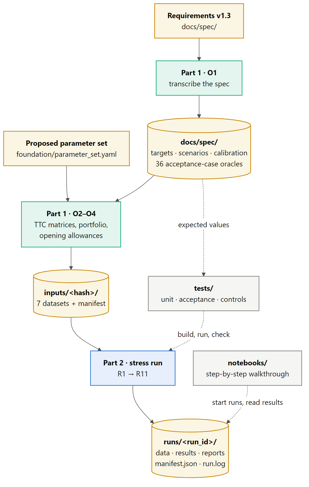

The code has two parts, and neither imports from the other:

- **Part 1, the one-off steps (`foundation/`).** O1 transcribes the requirements into data under `docs/spec/`. O2–O4 build the TTC matrices, the synthetic portfolio and the frozen opening allowances, and write them as one hashed input set under `inputs/<hash>/`. Their only products are files.
- **Part 2, the run pipeline (`src/stress/`).** The `stress` command runs R1–R11 on one input set and writes one write-once run folder under `runs/<run_id>/`.

The file boundary is deliberate. The engine treats synthetic and real data the same way, and a new starting point is a new input set, never an edit of an old one.

## 2.2 Repository layout

| Path | Content | Written by | Protection |
|---|---|---|---|
| `foundation/transcribe/` | O1: requirements to data | People, Claude Code | Normal review |
| `foundation/matrices/` | O2: TTC PD matrices and calibration | People, Claude Code | Normal review |
| `foundation/synth/` | O3–O4: generator, opening allowances, input-set writer | People, Claude Code | Normal review |
| `foundation/parameter_set.yaml` | Proposed synthetic parameter values | People, Claude Code | Normal review |
| `src/stress/` | The engine: `cli.py`, `contracts/` and one package per run step | People, Claude Code | Normal review |
| `tests/` | `unit/`, `acceptance/` (one test per AT), `controls/` | People, Claude Code | Normal review |
| `notebooks/` | Walkthrough notebook and `nbtools.py` | People, Claude Code | Normal review |
| `docs/spec/` | Requirements and their transcription | O1 only | Locked |
| `inputs/<hash>/` | Input sets: seven datasets and a manifest | O2–O4 only | Locked; R2 checks every hash |
| `runs/<run_id>/` | Run folders | R1–R11 only | Locked, write-once, sealed read-only; not in git |
| `archive/`, `inputs/bank/` | Material kept by people; future real data | Nobody in the build | Claude Code fully blocked; not in git |

## 2.3 Packages and import rules

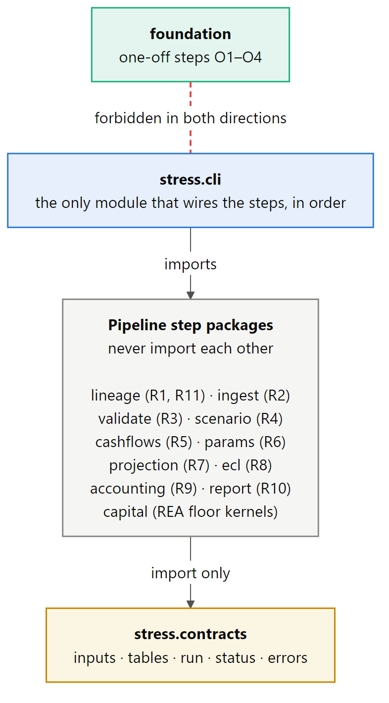

Three contracts in `pyproject.toml` are checked by `uv run lint-imports --cache-dir tests/.import_linter_cache` (the option keeps its cache out of the repository root):

1. **The engine imports nothing from the one-off steps.** `stress` must not import `foundation`.
2. **The one-off steps import nothing from the engine.** `foundation` must not import `stress`.
3. **Pipeline steps share only the contracts, and the CLI wires them.** This is a layers contract: `stress.cli` sits above the step packages, which sit above `stress.contracts`. A step package may not import a sibling step.

A step receives another step's output only as a table defined in `stress.contracts`. A test in `tests/controls/test_repository_rules.py` checks the same rule by parsing every import with `ast`.

## 2.4 Engineering rules

These rules come from `docs/architecture.md` §2. The code and its tests enforce them.

- **Single entry for inputs.** Every input enters through R2, and no later step reads a file.
- **Single source of cash flows.** R5 is the only step that creates cash flows. They are contractual and the same in every scenario.
- **One stress driver.** One Z per segment, country, year and scenario drives the PD matrix, LGD and prepayment, and nothing is stressed twice.
- **Missing is never zero.** Every input value carries a status, and a missing value blocks the calculation that needs it.
- **Precision.** Amounts are EUR, and rates and probabilities are decimal fractions. They are held as float64 and stay unrounded until R10.
- **Write-once runs.** A run folder is never changed after sealing; a rerun is a new folder. Baseline and adverse are never blended.
- **No hand-typed numbers.** Expected values come from `docs/spec/`, and computed values come from code.
- **Every test is traceable.** Each test carries `@pytest.mark.at(...)`, `req(...)` or `control(...)`.

## 2.5 Technology stack

| Concern | Choice |
|---|---|
| Language and packaging | Python ≥ 3.12, `uv` (lock file `uv.lock`), build backend hatchling |
| Numerics | numpy ≥ 2.0, scipy (`ndtr`, `ndtri` for Φ and Φ⁻¹), pandas ≥ 2.2 |
| File formats | Parquet through pyarrow (snappy) for tables; YAML (pyyaml) for scenarios and the parameter set; JSON for manifests |
| Excel output | openpyxl |
| Tests | pytest with strict markers and `--import-mode=importlib`; hypothesis for property tests |
| Static checks | ruff (line length 100), import-linter |
| Notebooks | jupyterlab, ipykernel, matplotlib (dependency group `notebooks`, installed by default) |
| Console entry point | `stress = "stress.cli:main"` |

## 2.6 Cross-cutting mechanisms

**Value status.** `stress.contracts.status.ValueStatus` has five values: `supplied`, `zero`, `not_applicable`, `estimated` and `missing`. Only `supplied`, `zero` and `estimated` are usable in a calculation. A dataset may carry a companion column `<field>__status`; otherwise R2 infers the status from the value (see §5.3).

**Blocking versus rejection.** A `BlockingError(step, code, message)` stops the run. R11 still seals the folder, with status BLOCKED and the step, code and message. A rejection removes one record: it is written to `rejections.parquet` with a reason code and never reaches a total. Requirement wording decides which applies (A17). Five reasons both reject and then block the run: `MISSING_CCF`, `CCF_OUT_OF_RANGE`, `NEGATIVE_AMOUNT`, `DUPLICATE_COMMITMENT` and `LIMIT_BREACH` (EAD-04, EAD-09).

**Table contracts.** Every table handed between steps has a `TableSpec` with a key and its columns. `TableSpec.check` blocks on a missing column (`MISSING_COLUMN`), a missing key value (`MISSING_KEY`) or a duplicate key (`DUPLICATE_KEY`), which implements MOD-06.

**Tolerances (§12.3).** These are transcribed into `docs/spec/targets.yaml` and copied into every parameter set.

| Name | Rule | Used for |
|---|---|---|
| `counts` | exact | IDs, counts, classification |
| `probability_identity` | absolute 1e-10 | Matrix row sums, PD-03 identities |
| `rate` | absolute 1e-10 | PD, LGD and CCF test cases |
| `amount` | absolute EUR 0.01 | Individual test-case amounts |
| `aggregate` | max(EUR 1, 1e-8 × amount) | Reconciliations |

**Determinism and hashing.** The engine uses no random numbers; the only randomness is in O3, with a fixed seed. Every step hands over its tables sorted by key, the CLI sorts concatenated results again with a stable sort, and Parquet is written with fixed settings. The run ID and times are kept out of all stored rows (A4), so a rerun writes byte-identical outputs. Hashes are SHA-256 throughout, at three levels:

- **Input set:** the hash of the sorted (file, file hash) pairs, of which the folder name keeps the first 16 hex characters.
- **Run:** every input copy and output file hashed in the manifest.
- **Run summary:** a digest over all output hashes.

**Logging.** Every step logs its start, facts and duration under the logger `stress.R<n>`. The console shows the same lines (`-q` shows warnings only), and `runs/<run_id>/run.log` keeps every line with millisecond timestamps.

# 3. Shared contracts (`stress.contracts`)

The contracts package is the only code that the step packages share. It holds no logic beyond validation of table shape.

## 3.1 Modules

| Module | Content |
|---|---|
| `status.py` | `ValueStatus` enumeration, `USABLE_STATUSES`, the `__status` companion-column suffix |
| `errors.py` | `BlockingError`; `Reason` (37 record-level rejection codes); `RUN_BLOCKING_REASONS`; `Block` (31 run-blocking codes). Appendix B lists them. |
| `run.py` | `RunConfig` (inputs, scenarios, variant, mode), `RunContext` (run ID, folders, versions, lineage), modes, status labels, file names |
| `inputs.py` | Vocabularies (products, profiles, stages, grade `D`, units); a `DatasetSpec` for each of the seven datasets; `TypedTable` (data plus a status frame of the same shape); `LoadedInputs` |
| `tables.py` | `TableSpec` and every inter-step table; the bundles `RoutedPortfolio`, `Drivers`, `Parameters`, `YearProjection` and `YearProvisions` |

## 3.2 The seven input datasets

| Dataset | File | Key | Main content |
|---|---|---|---|
| facilities | `facilities.parquet` | `facility_id` | Portfolio, segment, product, IFRS stage, POCI flag, accounting category, currency, principal, accrued interest and whether it is in GCA, GCA, limit, rate and rate type, residual maturity, repayment profile, regulatory approach and class, current and origination grade, TTC LGD, DPD, watchlist and forbearance flags, dates, collateral type, LTV, DSCR |
| obligors | `obligors.parquet` | `obligor_id` | Group, country, counterparty sector, NACE code and version, SME flag, regulatory default |
| commitments | `commitments.parquet` | `commitment_id` | Linked facility, currency, nominal undrawn, accounting CCF and its source, asset category `not_applicable` |
| opening_provisions | `opening_provisions.parquet` | `facility_id` | On-balance allowance, off-balance provision, overlay amount, risk, owner and reason, method, frozen flag |
| ttc_pd_matrix | `ttc_pd_matrix.parquet` | `segment`, `from_grade`, `to_grade` | One-year transition probability, grade ranks, master-scale PD of the from-grade |
| scenarios | `scenarios.yaml` | scenario, variable, year (and country) | Scenario set metadata, variables with units and value types, starting values, index definitions, one record per value |
| parameter_set | `parameter_set.yaml` | `parameter_set_id` | Horizon, master scale, per-segment parameters, terminal rule, conventions, tolerances, variants |

## 3.3 Tables handed between steps

| Table (file under `results/`) | Key | Producer | Content |
|---|---|---|---|
| `rejections` | record type, record ID, row, reason code | R3 | Rejected records with detail and step |
| `portfolio` (not written) | `facility_id` | R3 | Accepted facility joined with obligor, commitment and opening provision; route; SICR rank |
| `drivers` | segment, country, scenario, year | R4 | Z, its source (scenario path, reversion, flat) and the adverse weight |
| `driver_contributions` | as above plus driver | R4 | Value, mean, standard deviation, β, contribution |
| `indices` | scenario, country, variable, year | R4 | Annual change and compounded property index |
| `cf_schedule` | facility, valuation year, period | R5 | Period end, bucket year, fraction, t, opening balance, interest, principal, closing balance, discount factor, profile, generation, remaining maturity |
| `pit_matrices` | segment, country, scenario, year, from, to | R6 | PiT transition probability and the Z that produced it |
| `pd_curves` | segment, country, scenario, valuation year, cohort (grade), bucket, basis | R6 | q, m, S, F per whole-year bucket |
| `parameters` | facility, scenario, valuation year, cohort, bucket, basis | R6 | ParameterRecord: Z, LGD, prepayment rate, not-prepaid share, balance, DF, undrawn, CCF, EAD drawn, undrawn and total |
| `lgd_of_year` | facility, scenario, year | R6 | LGD of each projection year and the effective CCF |
| `slices` | scenario, year, facility, slice | R7 then R8 | Projection state: stage, grade, cohort data, GCA, undrawn, allowances, replacement generation |
| `stage_flows` | scenario, year, segment, from stage, to stage | R7 | GCA and undrawn flows |
| `grade_flows` | scenario, year, segment, country, from grade, to grade | R7 | GCA flows by grade |
| `provisions` | scenario, year, facility, slice | R8 | Method, raw and constrained on- and off-balance values, floor flag, masked amounts |
| `ecl_buckets` | scenario, valuation year, segment, stage, bucket | R8 | Performing ECL split by default bucket |
| `charges` | scenario, year, facility | R9 | Opening, closing and charge, on- and off-balance; overlays; FX and other movements (zero) |

## 3.4 Data flow between steps

| Step | Reads | Produces |
|---|---|---|
| R1 | Run configuration, input-set manifest | `RunContext`, `config.yaml` |
| R2 | The seven input files (the only file reads in the run) | `LoadedInputs`, `data/` copy |
| R3 | `LoadedInputs` | `RoutedPortfolio`, `rejections.parquet` |
| R4 | Scenario values and metadata, parameter set | `Drivers` |
| R5 | Accepted performing portfolio, parameter set, variant | `cf_schedule` |
| R6 | `RoutedPortfolio`, `cf_schedule`, `Drivers`, TTC matrices, parameter set | `Parameters` |
| R7 | Previous year's slices, the year's PiT matrices, portfolio, replacement generation from R5 | `YearProjection` |
| R8 | Projected slices, `Parameters`, Z table | `YearProvisions` |
| R9 | Previous and current slices | `charges` |
| R10 | Everything above | Reports, `summary.md`, `stress_report.xlsx`, headline |
| R11 | Run folder | `manifest.json`, read-only folder |

# 4. Part 1: one-off steps (`foundation/`)

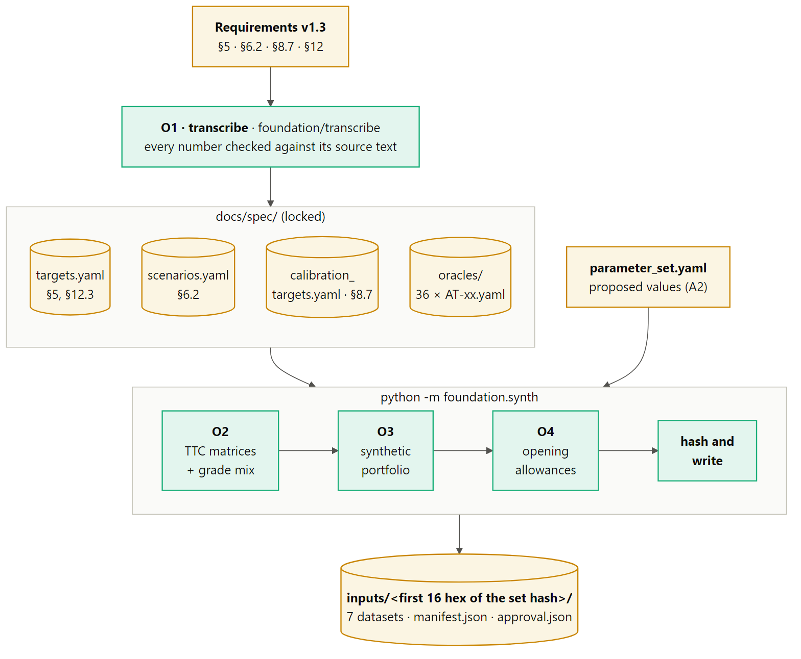

The one-off steps run only when their sources change:

- `uv run python -m foundation.transcribe` (O1) when the requirements change version (GOV-03);
- `uv run python -m foundation.synth` (O2–O4) when the parameter set, the generator or the spec data change.

O2–O4 always write a new input-set folder and never edit an existing one.

## 4.1 O1: transcribe the spec (`foundation/transcribe`)

O1 reads the requirements markdown and writes structured YAML under `docs/spec/`. Its central guarantee is that no number is typed by hand: every number in a transcribed record must appear in the source text it came from.

| Module | Responsibility |
|---|---|
| `markdown.py` | `Spec`: reads the document version and reference date, sections by heading, markdown tables as row dictionaries, requirement paragraphs. `NUMBER` reads numbers as written (thousands separators, decimals, exponents, percent), skipping IDs such as `S1`, `AT-25`, `End-2029` or `§5.2`. `check_transcribed` fails if any number in a record is absent from its source text, allowing fractions such as 5/6 and number words such as "five-sixths". |
| `targets.py` | `portfolio_targets`: §5.1–5.5, including portfolio sizes, stage counts and GCA, countries, IRB shares, P06 split, risk-profile ranges, NACE shares and top-ten-group concentration. `tolerances`: §12.3. |
| `scenarios.py` | `scenario_paths`: §6.2 paths for every country, with units, value types, starting values and the index definitions. `calibration_targets`: the §8.7 table of S1 and S2 PDs, reference LGD, life and EIR per segment. |
| `oracles.py` | One builder per acceptance case (36 builders). Each reads the case's input and expected-result text with keyword patterns. The record holds input, expected value, tolerance, unit, referenced requirement IDs and the named wrong answers ("not 27", "not 36"). |
| `__init__.py` | `build` assembles every file with a "generated, never edit" header; `write` writes them; `check` lists files that differ from what O1 would write now. |
| `__main__.py` | Command line: `--spec-dir` and `--check` (exit 1 if stale) |

**Outputs.**

| File | Content |
|---|---|
| `targets.yaml` | §5.1–5.5 targets and the §12.3 tolerances |
| `scenarios.yaml` | §6.2 baseline and adverse paths for NL, DE, FR, ES, IT and PL, 2027–2029, in percent, status SYNTHETIC |
| `calibration_targets.yaml` | §8.7 per segment: S1 PD, S2 PD, reference LGD, life and EIR |
| `oracles/AT-xx.yaml` | 36 records. 33 have status TRANSCRIBED; AT-48, AT-51 and AT-52 are PARTLY_OPEN because their numbers await the owner (A10). |

An oracle record looks like this (AT-42, abridged):

```yaml
id: AT-42
status: TRANSCRIBED
input: {segment: P03, stage: 1, pd: 0.04296875, lgd: 0.45, drawn: 800000.0,
        undrawn: 400000.0, ccf: 0.5, profile: bullet, prepayment_rate: 0, eir: 0.05}
expected: {ead_total: 1000000.0, ecl: 18415.1785714286, ecl_displayed: 18415.18}
tolerance: {name: amount, kind: abs, abs: 0.01}
```

## 4.2 O2: TTC PD matrices (`foundation/matrices`)

**Master scale.** There are N = 10 performing grades plus default D, shared by all seven reference segments (D13). The D column of every matrix is the grade's one-year TTC PD:

| Grade | G1 | G2 | G3 | G4 | G5 | G6 | G7 | G8 | G9 | G10 |
|---|---|---|---|---|---|---|---|---|---|---|
| One-year TTC PD | 0.02% | 0.05% | 0.12% | 0.30% | 0.70% | 1.60% | 3.00% | 4.80% | 9.00% | 18.00% |

**Matrix shape.** `build_matrix` builds each row i as follows:

- **Default.** The D cell is PD_i.
- **Staying.** The surviving mass (1 − PD_i) stays in grade i with probability `stay`.
- **Moving.** The rest moves: a share `downgrade_share` goes to worse grades and the remainder to better grades. Each further notch is `decay` times as likely as the one before.
- **D row.** D is absorbing.

| Segment | P01 | P02 | P03 | P04 | P05 | P06_GG | P06_CI |
|---|---|---|---|---|---|---|---|
| `stay` | 0.90 | 0.80 | 0.82 | 0.85 | 0.85 | 0.92 | 0.90 |
| `downgrade_share` | 0.55 | 0.55 | 0.55 | 0.55 | 0.55 | 0.55 | 0.55 |
| `decay` | 0.30 | 0.30 | 0.30 | 0.30 | 0.30 | 0.30 | 0.30 |

**Checks.** O2 refuses a matrix that breaks any of these conditions:

- every row sums to 1;
- no cell is negative;
- D is absorbing;
- PD rises strictly with the grade (AT-45);
- lifetime PD rises with the grade at every half-year horizon up to the longest maturity, which keeps the SICR line well defined.

**Calibration (SYN-PAR-05).** The matrices themselves are fixed by the master scale. Calibration is the grade mix that O3 assigns. For each segment and stage, `calibration_window` selects the grades that lie inside the portfolio's §5.4 PD range and within a factor of 3 of the §8.7 target; S2 grades start at G2, so a better origination grade exists. `tilt_weights` then finds exponential-tilt weights that hit the target exactly:

```text
w(g) ∝ exp(θ × ln PD(g)),   chosen so that   Σ_g w(g) × PD(g) = target PD
```

θ is found by bisection, and the last rounding residual is moved onto the two outer grades, so the drawn-exposure-weighted average PD equals the §8.7 target exactly. For example, P01's S1 grades average 0.80% and its S2 grades 4.00%. The calibration plan is stored in the input-set manifest.

## 4.3 O3: synthetic portfolio (`foundation/synth/generate.py`)

`Generator` builds facilities, obligors and commitments with a fixed seed (20261231). Every §5 target is hit exactly. The steps for each portfolio are:

1. **Counts and cell totals.** Exact facility counts per stage (§5.2) are split by segment. GCA per (segment, stage) cell follows the count shares. P06 is split 60/40 between general governments and credit institutions (A22).
2. **Grades.** Facility counts per grade follow the calibration weights by the largest-remainder method. S3 facilities get grade D.
3. **Obligors.** Facilities are grouped into obligors according to the portfolio design (for example P03: 1, 2 or 3 facilities with probabilities 0.5/0.3/0.2). Every facility of an obligor shares its country, sector, grade, stage and default status (SYN-01, A23).
4. **Facility attributes.**
   - Residual maturity is triangular on the §5.4 range, with the §8.7 reference life as its mode; 3% of facilities have exactly one year left where the range allows.
   - The origination grade is chosen so that the MIG-07 rule returns the facility's stage, with a relative margin of 1e-6 from the SICR line (SYN-PAR-08).
   - The TTC LGD is drawn from a beta distribution on the §5.4 LGD range with the §8.7 value as its mean (A13).
   - The rate scatters around the §8.7 reference EIR.
   - Product, contractual repayment profile, fixed/floating flag, collateral, LTV and DSCR are set, and accrued interest covers up to three months.
5. **Concentration.** The ten largest connected groups in P04 (40 facilities) and P05 (60 facilities) are formed from performing obligors (SYN-04).
6. **Raking.** Facility sizes are drawn lognormally, then scaled by iterative proportional fitting so that every GCA margin holds at once:
   - stage and calibration grade;
   - country (NL 30%, DE 20%, FR 15%, ES 10%, IT 10%, PL 15%);
   - IRB versus STA share;
   - NACE section (P03, P05);
   - the top-ten-group share (20% of P05, 25% of P04).
7. **Commitments and limits.** Revolvers in P03 and P05 carry the undrawn amounts (€600m and €1,400m) at the 50% accounting CCF. The contractual limit is principal plus undrawn.

| Portfolio | Products | Contractual profiles | Floating share | Sector |
|---|---|---|---|---|
| P01 | mortgage | annuity 90%, bullet 10% | 30% | households |
| P02 | consumer loan | annuity | 0% | households |
| P03 | term loan 60%, revolver 40% | term: linear 60%, bullet 40%; revolver: bullet | 60% | non-financial corporations (SME) |
| P04 | term loan | bullet 70%, linear 30% | 50% | non-financial corporations, CRE collateral |
| P05 | term loan 50%, revolver 50% | term: bullet 50%, linear 50%; revolver: bullet | 60% | non-financial corporations |
| P06 | debt security | bullet | 10% | general governments, credit institutions |

The contractual profile is stored as data. Which profile a run applies is set by the run's variant (§5.14). The resulting book has 10,000 facilities, 8,320 obligors and 931 commitments, with GCA of €11,000m and undrawn of €2,000m.

## 4.4 O4: opening allowances (`foundation/synth/allowances.py`)

O4 values every facility at end-2026 with the generator's own formula (SYN-PAR-09, D8, A8). It deliberately does not use the engine, so any difference between the two formulas shows as a first-year charge. The ingredients are:

- PD from the TTC matrix itself, with no Z shift;
- the TTC LGD;
- the TTC prepayment rate;
- a bullet schedule at the facility's rate and maturity;
- a final stub year that uses the constant-hazard convention.

```text
S1, on-balance    A = m[1] × GCA × LGD_TTC × DF[1]
S2, on-balance    A = Σ (k = 1 … K)  m[k] × GCA × (1 − CPR_TTC)^(k−1) × LGD_TTC × DF[k]
Off-balance       A = Σ over the same buckets  m[k] × U × CCF × LGD_TTC × DF[k]
S3                A = GCA × LGD_TTC          (off-balance: U × CCF × LGD_TTC)
```

Here `DF[k] = (1 + r)^−t(k)` discounts bucket k back to end-2026, and K is the number of buckets to maturity. Overlays are an explicit zero, with risk, owner and reason marked `not_applicable` (A24). The frozen totals are €261.0m on-balance and €17.6m off-balance, €278.6m in all.

## 4.5 Input-set writer (`foundation/synth/inputset.py`, `__init__.py`)

`build` runs O2, O3 and O4 and assembles two YAML documents:

- **Scenarios.** Every §6.2 value for every country, with unit, value type, source, release, completeness and status SYNTHETIC.
- **Parameter set.** The proposed values plus the values the spec fixes: segment CCFs from §5.1, tolerances, horizon years, the AT-35 utilisation CCF and the reversion length read from the AT-52 weights.

`write_input_set` then works in four steps:

1. It writes the seven files into a temporary folder.
2. It hashes each file and computes the set hash.
3. It writes `manifest.json` with every file's hash and row count, the control totals that R2 recomputes, and the generator name, version and seed and calibration plan. It also writes `approval.json` with status `PENDING_OWNER_APPROVAL`.
4. It moves the folder to `inputs/<first 16 hex>/`. If that folder already exists with the same hash, nothing changes; with a different hash, it fails.

`python -m foundation.synth approve <folder> --approver <name>` records the owner's approval without touching the data files.

## 4.6 The proposed parameter set (`foundation/parameter_set.yaml`)

All values are PROPOSED by Claude Code as working assumptions (A2) and await the owner.

| Segment | Z drivers (β) | ρ | SICR k | LGD w | CPR_TTC | v | CCF |
|---|---|---|---|---|---|---|---|
| P01 | GDP 0.4, unemployment −0.3, residential prices 0.3 | 0.15 | 2.5 | 0.20 | 6% | 0.25 | n/a |
| P02 | GDP 0.5, unemployment −0.5 | 0.06 | 2.0 | 0.10 | 10% | 0.20 | n/a |
| P03 | GDP 0.6, unemployment −0.2, rate −0.2 | 0.12 | 2.5 | 0.15 | 5% | 0.15 | 50% |
| P04 | GDP 0.3, CRE prices 0.5, rate −0.2 | 0.15 | 2.5 | 0.25 | 3% | 0.15 | n/a |
| P05 | GDP 0.7, rate −0.3 | 0.12 | 2.5 | 0.15 | 5% | 0.15 | 50% |
| P06_GG | GDP 0.8, rate −0.2 | 0.20 | 3.0 | 0.10 | 0% | 0 | n/a |
| P06_CI | GDP 0.6, unemployment −0.2, rate −0.2 | 0.20 | 3.0 | 0.10 | 0% | 0 | n/a |

| Driver | Mean μ | Standard deviation σ |
|---|---|---|
| Real GDP growth | 1.5% | 3.0% |
| Unemployment level | 6.5% | 2.0% |
| Residential price change | 2.5% | 8.0% |
| CRE price change | 2.0% | 10.0% |
| Reference rate level | 2.5% | 1.5% |

The **terminal rule** is a linear reversion of adverse Z to baseline 2029 over six years, with baseline flat, and Z extended to 2060. The **conventions** record the readings of open owner inputs: SICR horizon fixed at opening (A6), constant-hazard stub PD for O4 and the R3 SICR line (A7; R8 takes a part-year pro rata), calendar-year-end buckets, the new-S3 undrawn treatment (A9), and the opening allowances on the TTC matrix with a bullet schedule (A8). The **variants** are listed in §5.14.

## 4.7 Input sets in the repository

| Input set | Status | Difference |
|---|---|---|
| `514ed0e86e3dc760` | Current; used by every run and named in `CLAUDE.md` | Driver moments as in §4.6 |
| `32415eb9d5bbcd74` | Superseded first build | Identical except `parameter_set.yaml`, which has tighter driver standard deviations (for example GDP σ = 2%). That gave adverse Z of about −2 and a cumulative adverse charge of 7.6% of GCA, judged implausibly severe (A19). |

Both carry `approval.json` with status `PENDING_OWNER_APPROVAL`.

# 5. Part 2: the run pipeline (`src/stress/`)

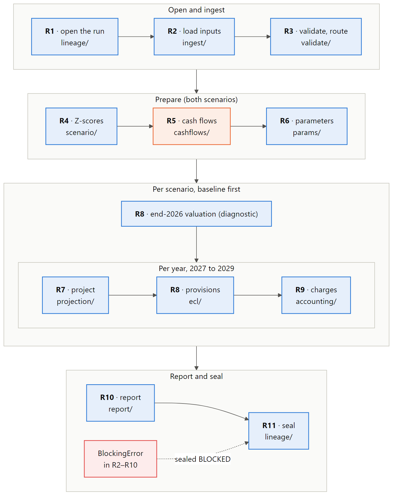

## 5.1 Orchestration (`cli.py`)

`cli.py` is the only module that imports the step packages and wires them together.

| Command | Purpose |
|---|---|
| `stress run --inputs inputs/<hash> [--scenarios baseline,adverse] [--variant core] [--mode synthetic] [--runs-dir runs] [-q]` | Run R1–R11 on one input set |
| `stress report --run runs/<run_id>` | Print the run's `summary.md`, or the blocking reason |
| `stress rerun --run runs/<run_id> [--runs-dir …] [-q]` | Rerun from the manifest's configuration into a new folder and compare every output hash |
| `stress compare --base runs/<a> --new runs/<b>` | Quantified difference of the impairment report between two runs (version-change control) |

| Exit code | Meaning |
|---|---|
| 0 | Sealed SYNTHETIC, or rerun reproduced |
| 1 | Engine fault: the folder is sealed BLOCKED with a traceback |
| 2 | Blocked: the folder is sealed BLOCKED with step, code and message (or R1 blocked before any folder exists) |
| 3 | Rerun not reproduced: the differing outputs are listed |

`execute(config, runs_dir)` runs R1, attaches the run log and calls `pipeline(ctx)`. It catches every `BlockingError`. Any other exception is turned into an `INTERNAL_ERROR` block, so no folder is ever left unsealed. It then closes the log and calls R11.

`pipeline(ctx)` runs R2–R6 once. For each scenario, baseline first (adverse reverts toward baseline 2029), it then:

1. builds the end-2026 slices from the portfolio and the frozen allowances;
2. runs R8 on them as a diagnostic of the opening;
3. loops over 2027–2029 through R7 (with that year's PiT matrices and replacement generations), R8 and R9.

The yearly results are concatenated, sorted by key and written once, and R10 returns the headline for the manifest. A full run on the 10,000-facility book takes about 25 seconds; R6 takes the largest share, about 6 seconds.

## 5.2 R1: open the run (`lineage/`)

`open_run` blocks before creating anything in four cases:

- **Unknown mode or regulatory mode** (`INVALID_ARGUMENT`, `REGULATORY_MODE`, D9).
- **Scenario list empty or repeated** (`INVALID_ARGUMENT`).
- **No input set at the path** (`INPUT_SET_NOT_FOUND`).
- **Folder name does not match the manifest's set hash** (`INPUT_HASH_MISMATCH`).

It then fixes the run's identity:

- **Code version** `0.1.0+<git SHA 12>`, with `+dirty.<digest>` when `src`, `foundation`, `pyproject.toml` or `uv.lock` have uncommitted changes.
- **Spec version** from the input-set manifest.
- **Run ID** `<yyyymmddThhmmZ>-<variant>-<hash8>`. The hash covers the config (with the input-set hash), the input set, the code version and the spec version, and a `-2`, `-3`… suffix keeps folder names unique.

R1 creates `runs/<run_id>/` with `config.yaml`, which holds no run ID or time. It returns a `RunContext` with status label SYNTHETIC and lineage data (git SHA, engine version, input-set generator and status).

## 5.3 R2: load inputs (`ingest/`)

`load_inputs` works in five stages:

1. **Hash check.** Each of the seven files is re-hashed and compared with the input-set manifest, and the set hash is recomputed and compared with R1 (`INPUT_HASH_MISMATCH`). A missing file blocks (`UNREADABLE_FILE`).
2. **Raw copy.** The seven files and the manifest are copied unchanged into `runs/<run_id>/data/` (DAT-03).
3. **Typed tables.** Each Parquet file is read against its `DatasetSpec`. An unknown or missing column blocks, and each column is cast to its kind (str, float, int, bool, ISO date). A bad value type blocks (`BAD_VALUE_TYPE`). Every value gets a status:

   | Situation | Status |
   |---|---|
   | Value is null, or an empty string for text | `missing` |
   | Numeric value equal to 0 | `zero` |
   | Any other value | `supplied` |
   | A `<field>__status` column is present | Its value wins, except that an absent value can only be `missing` or `not_applicable` |

4. **YAML documents.** `scenarios.yaml` must have its top-level keys. Every value needs a known unit (`SCENARIO_WITHOUT_UNIT`) and value type, and values are converted to decimal fractions by unit (percent × 0.01, A18). Duplicate values block. `parameter_set.yaml` must have its ten top-level keys (`MISSING_PARAMETER`). The TTC matrix may not contain a missing probability.
5. **Control totals.** Row counts, count and GCA per portfolio and stage, undrawn per portfolio, and the totals of GCA, undrawn and allowances are recomputed and compared with the manifest under the aggregate tolerance (`CONTROL_TOTAL_MISMATCH`).

The result is a `LoadedInputs` bundle. No later step reads a file.

## 5.4 R3: validate and route (`validate/`)

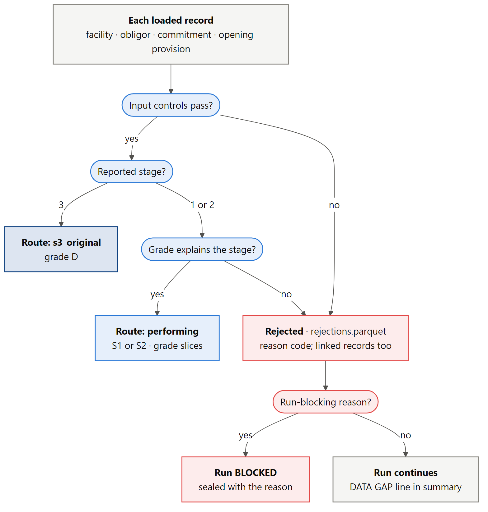

**Dataset checks (blocking).**

- **TTC matrices (PD-09, AT-45).** Grade labels must agree between segments, the scale must end in D, and ranks must run 1…N+1. Each matrix must have N+1 × N+1 cells, rows summing to 1 within 1e-10, no negative cell, D absorbing, and PD rising with the grade (`INVALID_MATRIX`). The matrix grades must equal the parameter set's master scale.
- **Parameter set.** The variant must exist (`UNKNOWN_VARIANT`). Every segment needs all its parameters, none OPEN, and at least one Z driver (`MISSING_PARAMETER`).
- **Snapshot date.** Every dataset must carry the parameter set's snapshot date, 2026-12-31 (`HORIZON_MISMATCH`, REG-01).

**Record controls (§12.2).** A failure rejects the record with a reason code. The table below groups the reason codes.

| Record | Checks and reason codes |
|---|---|
| Obligor | Duplicate ID (`DUPLICATE_OBLIGOR`) |
| Facility: identity and scope | Duplicate ID; obligor missing or rejected (`ORPHAN_FACILITY`); currency missing or not EUR; accounting category missing or not AC; POCI and central-bank exposures (not in v1) |
| Facility: classification | Unknown segment, country without scenario values (`UNMAPPED_COUNTRY`), unknown product, stage not 1–3, missing flags (`MISSING_FLAG`: a missing flag is never read as true or false) |
| Facility: amounts | GCA, principal, accrued interest or limit missing or negative; GCA ≠ principal + accrued interest counted once (`GCA_COMPONENTS_MISMATCH`); principal + undrawn above the limit (`LIMIT_BREACH`) |
| Facility: cash-flow inputs (performing) | Rate missing or ≤ −100%; maturity missing or ≤ 0; unknown repayment profile (EAD-10) |
| Facility: grades and LGD | Grade missing or not on the scale; S3 not in grade D, or performing in grade D (`STAGE_GRADE_CONFLICT`); regulatory default disagreeing with S3 (`DEFAULT_STAGE_CONFLICT`, DAT-04); TTC LGD missing or outside [0, 1] |
| Commitment | Duplicate ID, or more than one commitment per facility (`DUPLICATE_COMMITMENT`); orphan; currency; asset category not `not_applicable` (SCP-06); undrawn missing or negative; CCF missing on a positive undrawn amount (`MISSING_CCF`) or outside [0, 1]; CCF different from the parameter set (`CCF_MISMATCH`, A25); undrawn on a fully drawn product (`UNDRAWN_ON_TERM_PRODUCT`, EAD-03) |
| Opening provision | Duplicate; orphan; currency; amounts missing or negative; a facility without one (`MISSING_OPENING_PROVISION`) |
| Linked records | A rejected commitment or provision rejects its facility, and a rejected facility rejects its commitment and provision (`LINKED_RECORD_REJECTED`) |

**Grade explains stage (MIG-07, SYN-PAR-08).** For each surviving performing facility, R3 computes the SICR line from the segment's TTC matrix. The horizon is the facility's residual maturity at the opening date (A6), and a stub year uses the constant-hazard convention (`validate/sicr.py`):

```text
PD_life(g, H) = P^n(g, D) + Σ_j  P^n(g, j) × (1 − (1 − PD(j))^d)

P = the segment's TTC matrix, n = whole years in H, d = H − n (the stub)
```

The SICR rank is the best grade whose lifetime PD is at least k times that of the origination grade g₀. If the S2 grades do not form one block at the bad end of the scale, the run blocks (`MATRIX_NOT_MONOTONE`). The derived stage (2 at or beyond the line, otherwise 1) must equal the reported stage, or the facility is rejected (`STAGE_GRADE_CONFLICT`).

**Routing.** Accepted facilities take exactly one route: `performing` (S1 or S2) or `s3_original` (S3, grade D). The resulting `portfolio` table carries the joined obligor, commitment and provision fields, the grade ranks and the SICR rank.

**Reconciliation.** Per portfolio and stage, loaded must equal accepted plus rejected, with counts exact and GCA within the aggregate tolerance (`RECONCILIATION`). `rejections.parquet` is written before `raise_if_blocking` checks for run-blocking reasons, so the log always shows every record behind a block. With the committed input set, every facility is accepted and no record is rejected.

## 5.5 R4: scenarios and Z-score (`scenario/`)

**Provenance (SCN-04, §12.2).** Every requested scenario must exist in the input set, and the scenario, every value used and the scenario set must all be labelled SYNTHETIC. A synthetic scenario labelled official blocks (`SCENARIO_PROVENANCE`). An adverse run without baseline blocks (`BASELINE_REQUIRED`, A20), because adverse reverts toward baseline.

**Z-score (SCN-08).** For every segment, country, year 2027–2029 and scenario:

```text
Z(s, c, t) = Σ_i  β_i × (x_i(c, t) − μ_i) / σ_i        summed over the drivers i of segment s
```

A missing driver value or coefficient, or a non-positive σ, blocks. Nothing is carried forward or set to zero. Each driver's contribution is stored in `driver_contributions`.

**Terminal rule (ECL-10, D5).** With T = 2029 the last scenario year and R = 6 reversion years, Z is extended to 2060:

```text
a(t)           = max(0, (R − (t − T)) / R)
Z_adverse(t)   = a(t) × Z_adverse(T) + (1 − a(t)) × Z_baseline(T)
Z_baseline(t)  = Z_baseline(T)
```

The adverse weights run from 5/6 in 2030 down to 0 in 2035, so adverse is flat at baseline 2029 from 2035 on. Each row records its source (`scenario_path`, `reversion` or `flat`) and its weight.

**Property indices (SCN-05).** Annual property price changes compound from the starting level of 100: `I(t) = I(t−1) × (1 + g(t))`. The adverse residential index reaches 88.00, 79.20 and 76.824, and CRE reaches 85.00, 74.80 and 71.06 (AT-16).

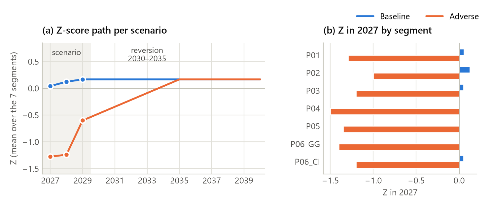

| Mean Z over segments | 2027 | 2028 | 2029 | 2030 | 2035 onward |
|---|---|---|---|---|---|
| Baseline | +0.04 | +0.12 | +0.17 | +0.17 | +0.17 |
| Adverse | −1.28 | −1.24 | −0.60 | −0.47 | +0.17 |

## 5.6 R5: contractual cash flows (`cashflows/`)

R5 is the only step that creates cash flows. They are contractual: no prepayment, default or drawdown happens here, so the schedule is the same in every scenario and is built once (EAD-10).

**Drawn measure (EAD-02, AT-37).** D is the GCA when accrued interest is already in GCA, otherwise principal plus accrued interest. Accrued interest is counted exactly once.

**Valuation dates and replacement (EAD-05, EXP-05, A15).** The schedule is built at each valuation year-end 2026, 2027, 2028 and 2029. At each valuation date it restarts from the static stock balance. A facility whose maturity has passed is replaced like for like with its starting residual maturity: `remaining_maturity` returns the remaining life and the replacement generation. In the reference run, 1,079 facilities have been replaced by end-2029.

**Periods.** There are yearly periods to maturity, and a final stub of fraction d where M is not whole (PD-06). Period ends are calendar year-ends, or the month-end of a stub maturity.

**Profiles (D12).** For period k with fraction d(k), cumulative time t(k) and opening balance B[k]:

| Item | Formula |
|---|---|
| Interest | `B[k] × ((1 + r)^d(k) − 1)` |
| Principal, bullet | 0, and the whole balance at the last period |
| Principal, annuity | `A − interest`, with `A = D × r / (1 − (1 + r)^−M)`, or `D / M` when r = 0; the last period pays off the rest |
| Principal, linear | `D × d(k) / M`; the last period pays off the rest |
| Discount factor | `DF[k] = (1 + r)^−t(k)`, from the default date back to the valuation date, applied once (ECL-08, AT-40) |

B[k], the opening balance of period k, is the contractual balance at default date k before that date's payment. It is what R6 turns into EAD.

![Figure 7: The contractual balance B[k] for the three repayment profiles, computed with the engine's own schedule kernel. The final half-year is a stub period.](images/fig-07-schedule-profiles.png)

**Implementation.** `kernels.contractual_schedule` is the readable scalar kernel used by tests. `schedules` computes all facilities at once as arrays with the same arithmetic. In the reference run, the schedule has 383,819 rows for 9,669 performing facilities over four valuation dates. R5 blocks on a non-positive maturity or a rate of −100% or lower; both are normally already rejected in R3.

## 5.7 R6: parameters (`params/`)

R6 builds every scenario-dependent value for each facility, scenario, valuation date and default bucket, baseline first. Its `CLAUDE.md` lists the "apply once" rules that the code follows.

| Module | Content |
|---|---|
| `matrix.py` | `pit_matrix` (TTC to PiT shift), `matrix_problems` and `check_matrix`, `pd_rises_with_grade` |
| `pd.py` | `Curve` (q, m, S, F); conversions from conditional and cumulative PDs; `stub_pd`; `curve_problems` and `check_curve` (PD-03); `grade_distributions` (matrix products) |
| `lgd.py` | `lgd_from_z`; `loss_weighted_lgd` with its numerator and denominator |
| `prepay.py` | `prepayment_rate`; `not_prepaid_share` |
| `ead.py` | `Ead` (drawn, undrawn, total); `check_ccf`; `ead`; kernels for the utilisation sensitivity, permitted transfer and regulatory EAD bridge (EAD-06, EAD-07) |
| `terminal.py` | `z_lookup`; `require_years` (a missing terminal year blocks, AT-41) |
| `store.py` | ParameterRecord finalisation: source version, adjustment 0, constraint `none`, key check and sort |
| `__init__.py` | `PitBook` cache, `pit_table`, `pd_curves`, `facility_parameters`, `effective_ccf`, `lgd_of_year`, `build_parameters` |

**TTC to PiT (PD-10, D13).** With C(i, j) the probability of ending in grade j or worse from grade i, and Φ the standard normal distribution function:

```text
C_PiT(i, j) = Φ( Φ⁻¹(C_TTC(i, j)) − √ρ × Z )
M_PiT(i, j) = C_PiT(i, j) − C_PiT(i, j + 1)
```

A worse economy (Z < 0) moves probability toward worse grades and default, and every row still sums to 1. Each PiT matrix is checked: rows sum to 1 within 1e-10, no negative cell, D absorbing and PD rising with the grade (`INVALID_PIT_MATRIX`, AT-46). Z = 0 gives back the TTC matrix exactly, as the LGD and prepayment rules give back their TTC values (D13). The first build divided by √(1 − ρ), which made Z = 0 the median year, well below the TTC average (a 0.80% TTC PD with ρ = 0.15 became 0.45%); the owner dropped the divisor on 18 October 2026 (A1). What the change gives up: with the divisor, the PiT PD averaged over Z ~ N(0, 1) gave back the TTC PD exactly. Without it, the cycle average lies above the TTC PD, at Φ(Φ⁻¹(PD_TTC) ÷ √(1 + ρ)): a 0.80% TTC PD with ρ = 0.15 averages 1.23%, and across the master scale the ratio is 1.04–1.46 at ρ = 0.06 and 1.12–3.08 at ρ = 0.20, highest for G1. "TTC" therefore now means the matrix of an average year (Z = 0), as LGD_TTC and CPR_TTC already do, not the average over the cycle (A29). The reference run of §8 predates that change. `PitBook` caches matrices by (segment, Z); the reference run needs 77 distinct shifts. PiT matrices are reported for 2027–2036.

**PD curves (PD-11, PD-03).** For every segment, country, scenario, valuation year and start grade g, the cumulative PD is the default column of a product of future PiT matrices:

```text
F_g[k] = ( e_g × M(y+1) × M(y+2) × … × M(y+k) )[D]      e_g = unit row vector of grade g
m[k]   = F[k] − F[k−1]                                  marginal PD
S[k]   = 1 − F[k]                                       survival
q[k]   = m[k] / S[k−1]                                  conditional PD
```

This allows for rating migration on the way to default, under the scenario's own future matrices (perfect foresight, ECL-06). Conditional PDs are never summed. Every curve is checked against the PD-03 identities within 1e-10 (`PD_IDENTITY`):

- every value lies in [0, 1];
- F does not decrease and S does not increase;
- F + S = 1;
- the marginal PDs sum to F.

Curves hold **whole years only**, up to the longest maturity in each segment and country. A final bucket shorter than a year has its whole-year row here, and R8 takes the part of it that the maturity covers (A7, §5.9). Until 18 October 2026, R6 also built a part-year row per grade with the constant hazard `Σ_j P[n](g, j) × (1 − (1 − PD(j))^d)`. The owner then decided to capture the part-year by the maturity in the ECL instead.

A run now stores 38,000 PD-curve records. The reference run of §8 stored 252,720, of which 214,720 were part-year rows. They are keyed by curve rather than by facility (A3), because every facility of a segment, country and grade shares one curve.


**LGD of the year (LGD-12, D4).**

```text
LGD[k] = Φ( Φ⁻¹(LGD_TTC) − w × Z[k] )
```

Z = 0 gives back the TTC LGD, a worse economy raises LGD, and the result stays in [0, 1] without a cap. A TTC LGD of exactly 0 or 1 passes through unchanged. No collateral data is used (A12). The run checks that every final LGD is in [0, 1] (`LGD_OUT_OF_RANGE`).

**Prepayment and EAD (EAD-11, D14).**

```text
CPR[t]          = Φ( Φ⁻¹(CPR_TTC) + v × Z[t] )
SP[1]           = 1
SP[k]           = (1 − CPR[1]) × (1 − CPR[2]) × … × (1 − CPR[k−1])

EAD_drawn[k]    = B[k] × SP[k]
EAD_undrawn[k]  = U × CCF
EAD[k]          = EAD_drawn[k] + EAD_undrawn[k]
```

Prepayment is applied once, in EAD, and never in the default survival. The undrawn amount is not prepaid, and EAD is never multiplied by PD inside the EAD calculation. All three EAD amounts are stored (EAD-02). The effective CCF is the variant's override for the segment if there is one, otherwise the commitment's own CCF. Without an undrawn amount the CCF is not applicable and is stored as missing, never as 0 (EAD-03). `check_ccf` blocks on a missing CCF for a positive undrawn amount or a CCF outside [0, 1].

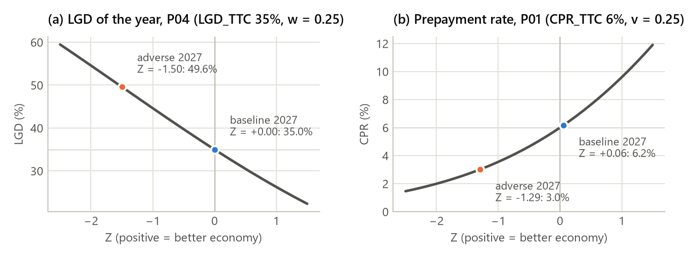

**ParameterRecords (MOD-06, MOD-05).** Facility records are keyed by facility, scenario, valuation year, cohort, default bucket and basis. Cohort is `performing`, because LGD, prepayment and EAD are the same for every performing grade slice of a facility (A3). The basis is `accounting`. `run_id` is implied by the run folder (A4). In v1 no adjustment or constraint is applied, so the final value equals the raw value; the S3 floor is a provision constraint and lives in R8. A duplicate or missing key blocks. The reference run stores 767,638 records. A separate `lgd_of_year` table holds each facility's LGD of each projection year and its effective CCF, for the S3 allowances and the end-2029 interpolation.

**Other blocks.** These conditions block in R6:

- a Z missing for any bucket year a facility needs (`MISSING_TERMINAL_INPUT`, AT-41);
- a PD curve that fails PD-03.

## 5.8 R7: project the year (`projection/`)

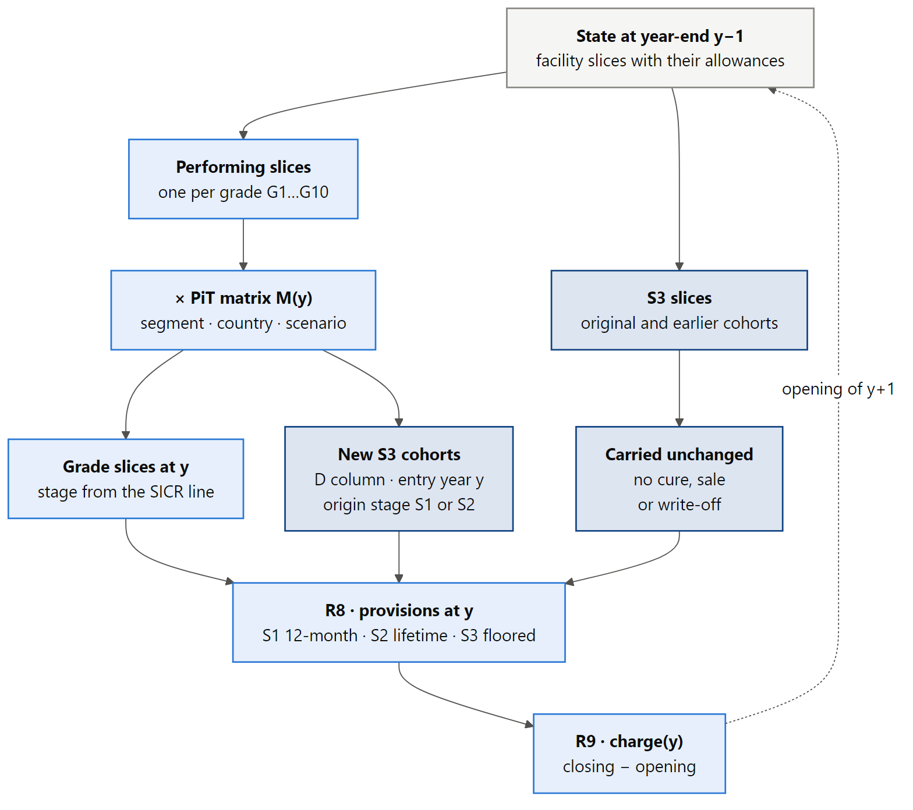

**State.** The projection state is a set of facility slices (D1, C4):

- one slice per performing grade the facility occupies;
- `S3_orig` for the original S3 book;
- one `S3_new_<year>_S<origin stage>` cohort per entry year and origin stage.

Slices carry fractional amounts (MIG-06). At end-2026 each facility has one slice: its current grade, or `S3_orig`.

**Migration (MIG-01, MIG-04).** For each segment and country, the facilities' grade vectors of GCA and undrawn are multiplied by the year's PiT matrix M(y). The performing part of the result gives the new grade slices. The default column gives the year's default flow, which becomes a new S3 cohort keyed by entry year and origin stage. PD is never applied again to that flow (PD-05). S3 slices bypass the matrix and carry their prior allowance: there is no cure, sale or write-off (EXP-02).

**Stage from grade (MIG-07, D2).**

```text
stage(g) = 3   if g = D
           2   if PD_life(g) ≥ k × PD_life(g0)       g0 = origination grade
           1   otherwise
```

The SICR rank comes from R3 and is fixed per facility, so only rating moves change stage. A slice returns to S1 when its grade improves back over the line, and D never cures.

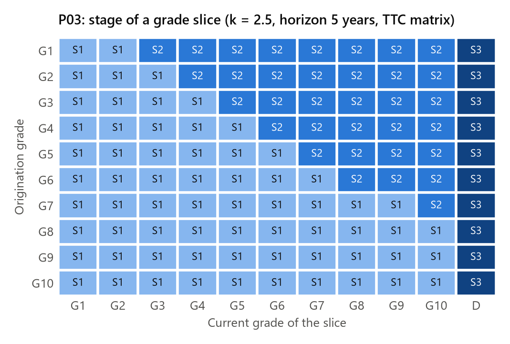

**Stage flows (MIG-08).** Stage transitions are sums of matrix cells grouped by each facility's SICR line: S1→S1, S1→S2, S1→S3, S2→S1, S2→S2 and S2→S3, plus S3→S3 for the existing stock. They are stored per segment as `stage_flows`, and the full grade-to-grade detail is stored as `grade_flows`.

**Replacement and static balance (EXP-01, REG-02).** Each slice records the replacement generation from R5 and whether the facility was replaced this year. `check_static` blocks if any facility's total GCA or undrawn differs from its previous level beyond the aggregate tolerance, or if a new facility appears (`STATIC_BALANCE`).

## 5.9 R8: year-end provisions (`ecl/`)

R8 values every slice at the year-end. It follows the "apply once" rules in `src/stress/ecl/CLAUDE.md`.

**Performing ECL (ECL-01 to ECL-08).** For each performing facility f and grade g, R8 computes the ECL the whole facility would have if it were entirely in grade g. Every term comes from rows selected by one key (scenario, valuation date, default bucket, basis), so PD, LGD and EAD always align (`PARAMETER_ALIGNMENT`, §12.2):

```text
ECL_12m(f, g)  = m_g[1] × EAD_f[1] × LGD_f[1] × DF_f[1]
ECL_life(f, g) = Σ (k = 1 … K_f)  m_g[k] × EAD_f[k] × LGD_f[k] × DF_f[k]

K_f = the facility's number of buckets to maturity, from R5
m_g[K_f] → d × m_g[K_f] when the final bucket covers only d years
```

The PD curves hold whole years. A final bucket of d years takes d × its whole-year marginal PD, pro rata by the maturity (A7, owner decision of 18 October 2026). A curve with a missing grade or bucket blocks (`PARAMETER_ALIGNMENT`).

The drawn part of EAD goes to the on-balance allowance and the undrawn part to the off-balance provision (EAD-08, AT-34). A slice's provision is the facility's per-grade ECL multiplied by the slice's share of the facility's GCA (on-balance) or undrawn (off-balance). S1 slices take the 12-month value and S2 slices the lifetime value to maturity.

**End-2029 S1 (ECL-05, ECL-10, AT-06).** At the last scenario year, the S1 12-month value uses the 2030 loss rate interpolated as a product:

```text
LR_2030 = a × PD_s(2029) × LGD_s(2029) + (1 − a) × PD_baseline(2029) × LGD_baseline(2029)
```

Here a = 5/6 for adverse and 1 for baseline. PD and LGD are not interpolated separately. A first bucket shorter than a year takes d × each PD first (A27), and a missing 2030 or baseline input blocks (AT-41).

**S3 (ECL-11, D6, A9, A14).**

| Slice | Raw value | Allowance |
|---|---|---|
| `S3_orig` | GCA × LGD of the year (+ undrawn × CCF × LGD off-balance) | max(raw, prior), per slice (AT-03, AT-18) |
| New cohort in its entry year | flow × LGD of the default year | Booked once at raw (AT-04) |
| New cohort in later years | flow × LGD of the year | max(raw, prior) |

**Methods and masking (ECL-09).** Each row records its method:

| Method | Used for |
|---|---|
| `s1_12m` | S1 slices |
| `s1_terminal_interpolated` | S1 slices at the last scenario year |
| `s2_lifetime` | S2 slices |
| `s3_original_floor` | `S3_orig` |
| `s3_new_booking` | A new S3 cohort in its entry year |
| `s3_new_floor` | A new S3 cohort in later years |
| `s3_opening_frozen` | S3 in the end-2026 diagnostic |

Raw and constrained values are both kept, together with the amount a binding floor masks. In the adverse 2029 valuation the floors bind on 28,408 S3 slices and mask €64.0m. `ecl_buckets` splits the performing ECL by default bucket, segment and stage.

**Opening diagnostic (A16).** At end-2026 the engine also values the opening book with its own formula. S3 keeps its frozen allowance. This is shown next to the frozen O4 allowances in the starting-point report and does not affect charges.

## 5.10 R9: stock to flow (`accounting/`)

**No-release check (REG-05, AT-18).** Every S3 slice present last year must still exist (`NOT_PERMITTED_MOVEMENT`), and no S3 slice may release provision on- or off-balance (`S3_RELEASE`). The check runs per slice, never on the total.

**Charge (ACC-01, AT-07).** Per facility, opening and closing are the sums of the allowances over the facility's slices at the previous and the current year-end:

```text
charge_on(y)  = closing_on(y)  − opening_on(y)
charge_off(y) = closing_off(y) − opening_off(y)
```

**Bridge (ACC-02, ACC-04).** FX movement is fixed at zero (EUR only, AT-21). Other movements are zero, since no write-offs, transfers or sales are permitted. Opening overlays are carried unchanged, so no overlay is counted twice. The bridge opening + charge + FX + other − closing must close to 1e-9 EUR.

## 5.11 R10: aggregate and report (`report/`, `capital/`)

R10 sums money from facility and bucket results and rounds only at the output boundary (§12.3, A26):

- report CSVs round EUR to cents and rates to 10 decimals;
- `summary.md` shows EUR millions to one decimal;
- every Parquet result stays unrounded.

Every report carries the run's status label.

**Reconciliations.** A failure here blocks the run (`RECONCILIATION`):

- Only EUR, AC-only facilities may reach the reports.
- **Starting point:** loaded GCA = accepted + rejected.
- **Static books per projected year (AT-44):** GCA, nominal undrawn and converted commitments per book, at the CCF the run applied.
- **Stage migration:** closing stage stocks equal the incoming flows, and S1 and S2 outflows equal the opening stocks (MIG-02).
- **Impairment:** charge = closing − opening per book and year, and the allowance stock equals the closing in the charges.
- **ECL by bucket:** the sum over buckets equals the performing provisions, on- and off-balance.

**Reports in `results/reports/`.**

| Family | Files | Content |
|---|---|---|
| Starting point | `starting_point_reconciliation.csv` | Per portfolio and stage: loaded, rejected and accepted counts and GCA; undrawn; converted commitments; frozen allowances next to the engine's end-2026 view per scenario; EUR-only and AC-only checks |
| Stage migration | `stage_migration.csv`, `s3_cohorts.csv`, `grade_migration.csv`, `static_books.csv` | Opening, flows and closing by stage; S3 stock by cohort; grade-to-grade GCA flows; AT-44 books per year |
| Parameters | `z_scores.csv`, `driver_contributions.csv`, `property_indices.csv`, `ttc_matrices.csv`, `pit_matrices.csv`, `pd_curves.csv`, `portfolio_pd.csv`, `lgd_by_z.csv`, `ead_profile.csv`, `ecl_by_bucket.csv` | Z and its drivers; matrices; PD curves; one-year portfolio PD as Σ(D·q)/ΣD with numerator and denominator (RPT-06); GCA-weighted LGD by Z; EAD profile by bucket; ECL by bucket |
| Impairment | `impairment.csv`, `impairment_by_stage.csv` | Opening, charge and closing, on- and off-balance, and cumulative charge per portfolio and total; coverage by stage with numerator and denominator |
| Summary | `summary.md` | Headline per scenario, impairment and stage-mix tables, static books, starting point, and a DATA GAP line if records were rejected (OPS-07) |
| Workbook | `stress_report.xlsx` | Results in EUR millions for people (below) |

**Excel workbook (`report/excel.py`).** The workbook shows the run by portfolio, baseline next to adverse:

- Engine results are written as values in blue. Every derived figure is an Excel formula in black, so the sheet recalculates and can be traced: totals, coverage, cost of risk, adverse minus baseline and the summary KPIs.
- Display formats round; stored values do not.
- The workbook is byte-reproducible: document and zip-entry times are fixed, and it leaves out the run ID (A28).

| Sheet | Content |
|---|---|
| Summary | Key results for the whole book, a bar chart of cumulative charge by portfolio, a line chart of total provisions by year-end |
| Portfolios | The book at end-2026 by portfolio |
| Results by portfolio | Baseline and adverse side by side, with differences |
| Impairment | Opening, charge and closing per scenario, year and portfolio |
| Stage migration | Stage stocks and flows |
| Coverage by stage | Allowance over GCA per stage |
| S3 cohorts | S3 stock and allowance per cohort |
| Parameters | Z by segment and year; one-year PD (RPT-06); LGD of the year (LGD-12) |
| Starting point | The reconciliation and the frozen-versus-engine opening view |
| Checks | Every control applied, step by step, with its outcome, and rejected records by reason |
| Notes | Status, input set, parameter set, variant, versions, horizon and portfolio names |

**Run comparison.** `compare_runs` joins the `impairment.csv` of two runs on scenario, year and portfolio. It reports base, new and difference for closing allowances, charge and cumulative charge.

**Capital kernels (`capital/`).** `methodological_floor` applies the starting-point floor separately to the IRB and STA REA contributions (CAP-03, AT-10). `output_floor` computes the bank-wide comparison max(UTREA, factor × STREA) (CAP-04, AT-11). Nothing in v1 feeds them portfolio REA.

## 5.12 R11: seal the run (`lineage/`)

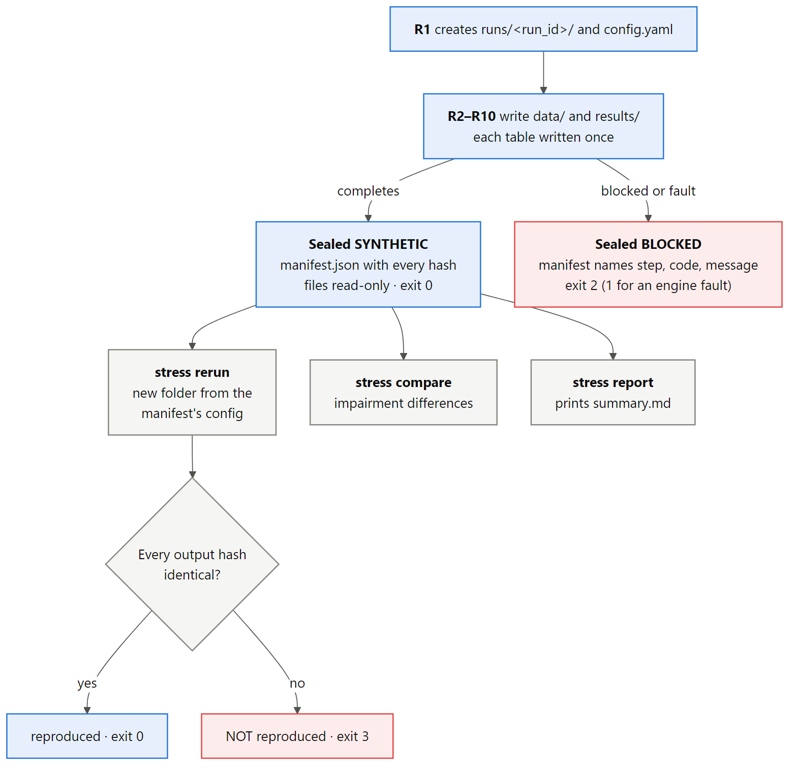

`seal_run` writes `manifest.json` and makes every file in the folder read-only. A blocked run is sealed too.

| Manifest field | Content |
|---|---|
| `run_id`, `status`, `label`, `mode` | Identity; status is SYNTHETIC or BLOCKED |
| `created_at`, `sealed_at` | Times (only here, never in outputs) |
| `config`, `config_sha256` | The run as invoked, with the input-set hash |
| `input_set_hash`, `input_manifest` | Input set and its generator and status |
| `code_version`, `git_sha`, `engine_version`, `spec_version` | Versions |
| `parameter_set`, `load_controls`, `rejections` | Parameter-set ID, version and status; row counts; rejection counts |
| `inputs` | SHA-256 of every file in `data/` |
| `outputs`, `outputs_digest` | SHA-256 of every file under `results/` (34 in the reference run) and a digest over them |
| `log` | Hash of `run.log`, for integrity only; the log carries times, so it is not an output a rerun must reproduce (A28) |
| `summary` | The headline lines from R10 |
| `blocked` | Step, code and message, when blocked |

**Reproducibility (§12.2).** `stress rerun` reads the configuration from the manifest, runs it into a new folder and compares every output hash and the status. The control tests `test_rerun_reproduces_every_output` and `test_excel_report_is_byte_reproducible` check that a rerun reproduces every output hash, including the Excel workbook. In `runs/`, the three runs of the reference configuration (`20261017T2301Z`, `2302Z` and `2304Z`, all `core-b559d9dd`) have the same outputs digest.

## 5.13 Worked example: AT-42 through the pipeline

The P03 opening-S1 reference facility, valued at 31 December 2026 with the default bucket ending 31 December 2027. Every value is the spec's oracle. The acceptance test checks it once through the kernels and once through a full engine run on a small input set that contains this facility.

| Step | Quantity | Value |
|---|---|---|
| R5 | Balance at the default date (drawn, bullet, so flat) | B = €800,000 |
| R5 | Discount factor for one year at 5% | 1 / 1.05 |
| R6 | EAD = 800,000 × SP (= 1, no prepayment) + 50% × 400,000 | €1,000,000 |
| R6 | PD of the 2027 bucket, given by the case | 4.296875% |
| R6 | LGD of 2027, given by the case | 45% |
| R8 | ECL = m × EAD × LGD × DF, unrounded | €18,415.1785714286 |
| R10 | Reported, rounded only at output | €18,415.18 |

## 5.14 Variants

A variant is a separate, labelled run (`--variant`, run ID `…-<variant>-…`). Each is defined in the parameter set (A11), and the core run is unchanged by the others.

| Variant | Repayment profile | CCF |
|---|---|---|
| `core` | Bullet for every facility (SYN-PAR-07) | Commitment's own CCF (50% for P03 and P05) |
| `annuity` | Annuity for mortgages, consumer loans and term loans; revolvers and debt securities stay bullet | As core |
| `linear` | Linear for the same products | As core |
| `utilisation` | Bullet | P03 and P05 raised to the AT-35 value of 75% |

# 6. Run folder and outputs

```
runs/<run_id>/
├── config.yaml              R1: the run as invoked (no run ID, no time)
├── run.log                  every step's facts, checks and timings
├── manifest.json            R11: versions, status, hashes of every input and output
├── data/                    R2: unchanged copy of the seven datasets and the input manifest
└── results/
    ├── rejections.parquet   R3
    ├── drivers.parquet, driver_contributions.parquet, indices.parquet     R4
    ├── cf_schedule.parquet  R5
    ├── pit_matrices.parquet, pd_curves.parquet, parameters.parquet,
    │   lgd_of_year.parquet  R6
    ├── slices.parquet, stage_flows.parquet, grade_flows.parquet           R7 (slices with R8 allowances)
    ├── provisions.parquet, ecl_buckets.parquet                            R8
    ├── charges.parquet      R9
    └── reports/             R10: 17 CSV reports, summary.md, stress_report.xlsx
```

Run folders are local and never committed; the pre-commit hook refuses them. Each folder holds what is needed to reproduce and explain the run: the configuration, the exact input data and the results.

# 7. Verification and testing

## 7.1 Test architecture

The suite has 105 test functions in three folders. Hypothesis property tests and parametrised cases run many examples per function.

| Folder | Files | Tests | Marker |
|---|---|---|---|
| `tests/acceptance/` | One file per acceptance case, `test_at_xx.py` | 36 | `@pytest.mark.at("AT-xx")` |
| `tests/unit/` | `test_kernels.py`, `test_foundation.py`, `test_run_frame.py`, `test_reporting.py`, `test_terminal_s1.py`, `test_part_year_bucket.py` | 45 | `@pytest.mark.req(...)` |
| `tests/controls/` | `test_input_controls.py`, `test_run_controls.py`, `test_repository_rules.py` | 24 | `@pytest.mark.control(...)` |

**Traceability rule.** `tests/conftest.py` fails collection if a test has no `at`, `req` or `control` marker. It also fails if a marker names an unknown ID: an AT without an oracle file, a requirement ID absent from the requirements text, or a control that is not a §12.2 control name (or "Repository rules").

**Oracles.** `tests/support.py` loads expected values, tolerances and named wrong answers from `docs/spec/oracles/` and compares with the §12.3 tolerance kinds (`exact`, `abs`, `max_abs_rel`). No oracle number is typed into a test.

**Fixtures and builders (`tests/builders.py`).**

| Fixture | What it provides |
|---|---|
| `full_inputs` | O2–O4 rebuilt into a temporary folder. The generator is deterministic, so this has the same hash as the committed input set. |
| `core_run` | One full core run of both scenarios on the full synthetic book |
| `mini` | A few facilities per segment and stage plus one revolver per book with commitments. Tests change one field to plant a defect and write a new hashed input set. |
| `reference_runs` | Two P03 S1 revolvers carrying the AT-34 and AT-42 inputs, run in the `core` and `utilisation` variants |

## 7.2 Acceptance cases

| Area | Acceptance cases | Proven at |
|---|---|---|
| Starting point and scope | AT-01 (book totals), AT-21 (EUR only, FX zero), AT-22 (AC allocation, stage and approach totals), AT-44 (static books in every year) | Input set and full run |
| TTC and PiT matrices | AT-45 (TTC matrix validity), AT-46 (PiT validity for several Z), AT-47 (PD rises as Z falls) | Kernels and input set |
| Scenarios | AT-16 (compounded index), AT-52 (Z at the means, missing coefficient blocks, reversion weights) | Kernels and run |
| PD arithmetic | AT-25 (conditional to marginal and cumulative), AT-28 (stub PD) | Kernels |
| LGD | AT-33 (zero EAD gives zero loss, LGD not applicable), AT-49 (LGD-12 bounds and monotonicity) | Kernels |
| EAD and CCF | AT-08 (120, not 140 or 160), AT-34 (drawn/undrawn split), AT-35 (utilisation variant run), AT-36 (permitted transfer), AT-37 (accrued interest once), AT-38 (regulatory bridge), AT-50 (prepayment in EAD only) | Kernels and runs |
| Cash flows | AT-51 (bullet, annuity, linear and stub schedules) | Kernels |
| Stages | AT-02 (stage arithmetic), AT-29 (aligned default flows), AT-48 (SICR rule) | Kernels and run |
| Provisions | AT-03 (S3 floor), AT-04 (new S3 booking), AT-05 (S1 loss rate), AT-06 (2030 interpolation), AT-18 (no release per exposure), AT-39 (S1 and lifetime ECL, "not 36"), AT-40 (discount once), AT-41 (missing 2030 input blocks), AT-42 (P03 reference) | Kernels and runs |
| Accounting | AT-07 (charge 7, "not 27") | Kernels |
| Capital | AT-10 (methodological floor), AT-11 (output floor) | Kernels |

AT-48, AT-51 and AT-52 test the rule each case states. Their numerical expectations stay open until the owner approves them (A10).

## 7.3 Unit and property tests

| File | What it proves |
|---|---|
| `test_kernels.py` (24) | Z is zero at the means and linear; a missing driver value blocks; reversion weights and path; indices compound; schedule identities; like-for-like replacement; PiT validity, Z = 0 and ρ = 0 returning the TTC matrix, and the one-grade closed form of the D column; PD-03 identities; curves from matrix products; stub PD; LGD bounds; not-prepaid share; EAD bounds and the CCF contract; stage flows conserve the book; stage of rank; floors never release; ECL as a sum of products; charge as stock change; REA floor kernels |
| `test_foundation.py` (6) | O1 files are current; transcription rejects numbers not in the source; calibration hits every stage target; the generator is deterministic and matches the committed set; opening allowances follow the generator formula; the parameter set documents its status |
| `test_run_frame.py` (7) | Duplicate or missing key blocks; value status distinguishes missing, zero and supplied; run ID and write-once; a sealed run is labelled and read-only; a tampered input blocks; a scenario value without unit blocks; raw files are kept unchanged |
| `test_reporting.py` (4) | The run log records every step; a blocked run's log names the reason; the Excel report matches the engine; the workbook is byte-reproducible |
| `test_terminal_s1.py` (1) | The run interpolates the 2030 S1 loss rate |
| `test_part_year_bucket.py` (5) | Curves hold whole years; a part-year bucket takes d × its whole-year marginal PD in S1, S2 and end-2029 S1; the pro-rata kernel never exceeds the constant hazard |

## 7.4 Control tests (§12.2)

| File | Controls |
|---|---|
| `test_input_controls.py` | Duplicate facility; currency and accounting scope; unmapped country; grade must explain stage; cash-flow inputs; EAD/CCF contract; a missing flag is never a default; LGD rule |
| `test_run_controls.py` | Probability range and row sums; D must be absorbing; PD-curve identities block; parameter alignment; S3 bypasses performing PD; missing scenario value blocks; regulatory mode blocks; a synthetic scenario labelled official blocks; static balance; rerun reproduces every output; version-change difference report; missing prepayment rate blocks |
| `test_repository_rules.py` | No imports across parts or between steps; every acceptance case has exactly one test; an unmarked test fails collection |

## 7.5 Quality gate

A change is complete only when three checks pass:

```
uv run pytest                                               # all tests; -m at for acceptance cases only
uv run lint-imports --cache-dir tests/.import_linter_cache  # the three import contracts
uv run ruff check                                           # lint, including notebooks and docs
```

A full run must also seal, and `stress compare` against the previous run must show the intended effect. Claude Code's reviewer approved each part of the v1 build against this gate, and every later change needs the `change-reviewer`'s approval (§9).

# 8. Reference run results

All figures in this section come from `runs/20261017T2304Z-core-b559d9dd/`. It is a core run of baseline and adverse on input set `514ed0e86e3dc760` with the PROPOSED parameter set. It predates the owner's decision of 18 October 2026 to drop the √(1 − ρ) divisor of the PD-10 shift (D13); §8.3 gives the main figures after it. These are synthetic preparation results, not an EBA submission and not a bank forecast.

| Fact | Value |
|---|---|
| Facilities accepted / rejected | 10,000 / 0 (9,669 performing, 331 original S3) |
| GCA, undrawn, converted commitments | €11,000.0m, €2,000.0m, €1,000.0m (static in every year) |
| Frozen opening allowances (O4) | €278.6m |
| Schedule rows, PD-curve records, ParameterRecords | 383,819; 252,720; 767,638 |
| Distinct PiT shifts | 77 |
| Facilities replaced like for like by 2029 | 1,079 |
| Outputs hashed | 34 |
| Run time | 25.1 s |

## 8.1 Stage migration

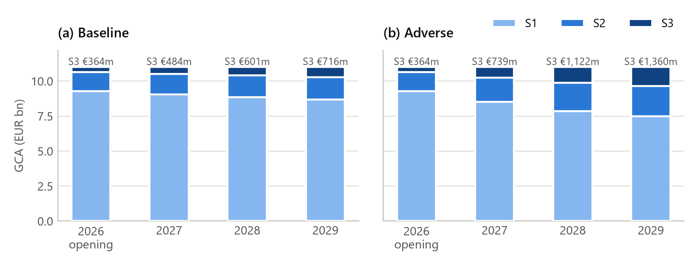

| GCA, EUR m | 2026 | 2027 | 2028 | 2029 |
|---|---|---|---|---|
| Baseline S1 | 9,267.6 | 9,050.1 | 8,860.0 | 8,687.7 |
| Baseline S2 | 1,368.6 | 1,466.2 | 1,539.3 | 1,595.9 |
| Baseline S3 | 363.8 | 483.6 | 600.7 | 716.5 |
| Adverse S1 | 9,267.6 | 8,526.1 | 7,855.4 | 7,499.2 |
| Adverse S2 | 1,368.6 | 1,735.0 | 2,022.4 | 2,140.4 |
| Adverse S3 | 363.8 | 738.9 | 1,122.2 | 1,360.4 |

## 8.2 Provisions and charges

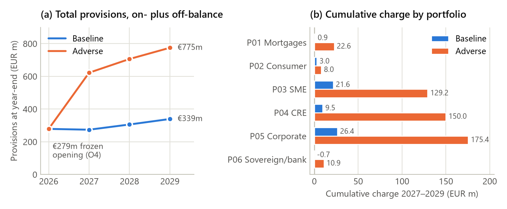

| EUR m | Year | Opening | Charge | Closing | Cumulative charge |
|---|---|---|---|---|---|
| Baseline | 2027 | 278.6 | −5.0 | 273.6 | −5.0 |
| Baseline | 2028 | 273.6 | 32.0 | 305.6 | 26.9 |
| Baseline | 2029 | 305.6 | 33.6 | 339.2 | 60.6 |
| Adverse | 2027 | 278.6 | 343.5 | 622.1 | 343.5 |
| Adverse | 2028 | 622.1 | 83.7 | 705.9 | 427.3 |
| Adverse | 2029 | 705.9 | 68.8 | 774.6 | 496.0 |

| Cumulative charge 2027–2029, EUR m | P01 | P02 | P03 | P04 | P05 | P06 | Total |
|---|---|---|---|---|---|---|---|
| Baseline | 0.9 | 3.0 | 21.6 | 9.5 | 26.4 | −0.7 | 60.6 |
| Adverse | 22.6 | 8.0 | 129.2 | 150.0 | 175.4 | 10.9 | 496.0 |

## 8.3 Points for the owner's review

- **First-year charge from O4.** O4 values the opening book at TTC. In the reference run, baseline Z ≈ 0 was the median year, well below TTC, because of the √(1 − ρ) divisor. The engine's own end-2026 view was €238.2m for baseline and €439.9m for adverse, against the frozen €278.6m, so baseline 2027 released €5.0m and adverse 2027 charged €343.5m. The owner dropped the divisor on 18 October 2026 (D13), so Z = 0 now gives back the TTC matrix. On the same input set (run `20261018T2154Z-core-c10c21fd`) the engine's end-2026 view is €267.3m for baseline and €495.0m for adverse. Baseline 2027 now charges €38.9m and adverse 2027 €439.5m. The cumulative 2027–2029 charge is €129.7m in the baseline and €634.9m in the adverse (5.8% of GCA). The rest of the opening gap comes from the baseline Z sitting at or slightly above 0 (0.00 to +0.25); where it is exactly 0.00 (P04, P05, P06_GG in 2027), the engine's S1 valuation equals O4 to the cent. The starting-point report shows both views.
- **S3 build-up.** With no cures, sales or write-offs (EXP-02), S3 grows from €364m to €717m in the baseline and to €1,360m in the adverse by end-2029 in the reference run; without the divisor, to €846m and €1,601m.
- **Floors.** S3 floors bind widely in later years. In the adverse 2029 valuation they bind on 28,408 S3 slices and mask €64.0m, which the provisions table reports.

# 9. Development tooling and governance

## 9.1 Working rules for Claude Code

The repository was built with Claude Code under explicit rules.

| Component | Location | Function |
|---|---|---|
| Root rules | `CLAUDE.md` | Where to look, build order, the dedicated-branch rule (never commit to `main` without permission), protected folders, commands |
| Step rules | `src/stress/params/CLAUDE.md`, `src/stress/ecl/CLAUDE.md` | The "apply once" rules for R6 and R8: prepayment only in EAD, discount once, S3 floors per exposure, never apply PD to a new-S3 flow, and so on |
| Deny rules | `.claude/settings.json` | No reads or edits of the two protected folders; no hand edits of `docs/spec/`, `inputs/<hash>/` or `runs/<run_id>/` |
| Guard hook | `.claude/hooks/guard_paths.py` (PreToolUse, every tool call, subagents included) | Blocks any call whose path, glob or command names a protected folder as a path segment (any case or slash direction), and blocks `git grep`. Exit code 2 blocks the call and fails closed on bad input. It runs with `py -3 -I`, so it works under any virtualenv. |
| Test gate | `.claude/hooks/test_gate.py` (Stop hook, 1,200 s timeout) | When files under `src/`, `foundation/`, `tests/` or `pyproject.toml` changed, runs pytest, lint-imports and ruff, and blocks the stop until they pass |
| Pre-commit | `tests/githooks/pre-commit` (enable with `git config core.hooksPath tests/githooks`) | Refuses protected paths and run folders, then runs ruff, lint-imports and pytest |
| Change skill | `.claude/skills/improve/SKILL.md` (`/improve <change>`) | One improvement on its own branch: read, baseline run, tests first, build, gate, new run and comparison, review, records |
| Reviewer | `.claude/agents/change-reviewer.md` | Read-only reviewer that returns APPROVE or CHANGES REQUESTED against purpose, tests, design fidelity, repository rules, controls, effect on results, inputs and records |
| Search and tool excludes | `.gitignore`, `.gitattributes`, `.ignore`, ruff and pytest settings | Keep the protected folders out of git, diffs, ripgrep and tool scans |

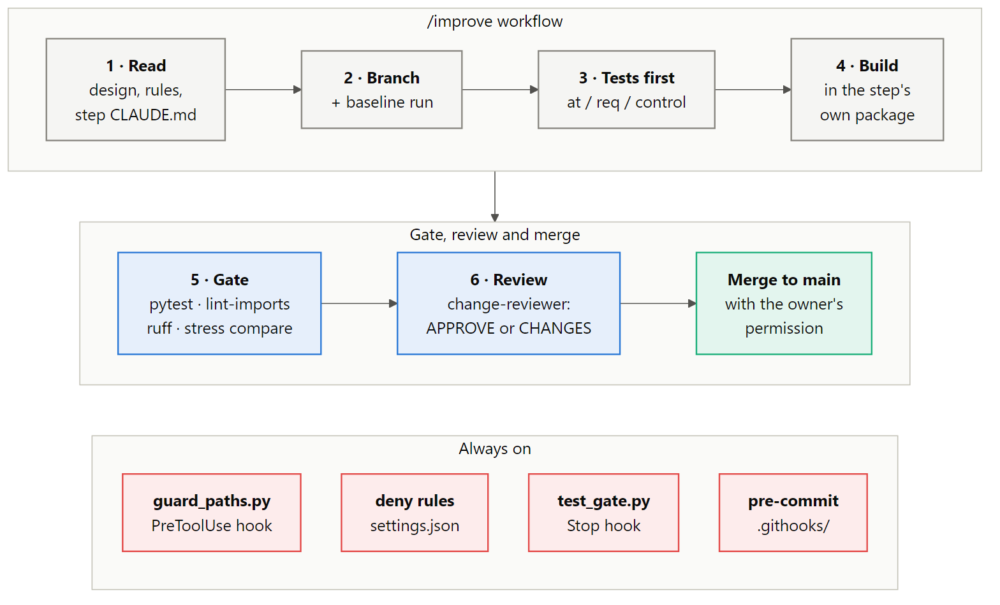

During the v1 build, each build step was made with a `/build-step` command and approved by a `step-reviewer` agent. With v1 complete, the repository has moved to maintenance: `/improve` and `change-reviewer` take their place.

**Known limits of the protection** (`docs/architecture.md` §4):

- It is not an OS-level block: a script that walks the whole tree could still read a protected folder.
- The hook blocks any command that merely mentions a protected folder.
- The hooks do not yet fail closed on a hook error. That needs a CLI upgrade, and a person must then run the protection check in `docs/runbook.md` (C7).

## 9.2 Notebooks

`notebooks/01_full_run_walkthrough.ipynb` (60 cells) runs R1–R11 through `stress.cli.execute`, so it writes an ordinary sealed run. It then reads every step's tables back from the run folder: the book at the starting point, the parameter set, routing, Z, cash flows, PiT minus TTC heatmaps, PD curves, LGD, EAD, stage flows, S3 cohorts, provisions and charges. It follows one facility from its cash flows to its charge. A notebook never wires steps or edits run folders, and its checks recompute identities from the run's own tables.

`notebooks/nbtools.py` provides:

- `run_engine(inputs, scenarios, variant)`, which raises with the reason if the run blocks;
- `open_run("latest" | run_id)` and `list_runs()`, `input_sets()`;
- a `Run` object with `table()`, `data()`, `report()`, `overview()` and `outputs()`;
- `reproduction(run)`, which compares the run with others of the same configuration;
- display helpers in the same colour scheme as the figures in this document.

# 10. Operating the engine

**Setup.**

```
uv sync
git config core.hooksPath tests/githooks
```

**A full run.**

```
uv run stress run --inputs inputs/514ed0e86e3dc760 --scenarios baseline,adverse --variant core
```

The command prints the run ID, the status and two headline lines. Exit code 0 means sealed SYNTHETIC, and exit code 2 means blocked: the reason is in `manifest.json` under `blocked`. Read `results/reports/stress_report.xlsx` for the results and `run.log` for what each step did, and check that `rejections.parquet` is empty. Then confirm reproducibility:

```
uv run stress rerun --run runs/<run_id>
```

**After changing the requirements or the parameter set** (`docs/runbook.md`):

1. **Requirements changed.** Run `uv run python -m foundation.transcribe`. Review the diff of `docs/spec/` and have it approved (GOV-03).
2. **Parameter set or generator changed.** Run `uv run python -m foundation.synth`. It writes a new `inputs/<hash>/`; update the hash wherever it is named.
3. **Tests.** Run `uv run pytest`. The determinism test fails until the new input set is in `inputs/`.
4. **Comparison.** Compare the old and new results with `uv run stress compare --base runs/<old> --new runs/<new>`.

**Protection check.** After any change to `.claude/` or a Claude Code upgrade, a person plants canary files in the protected folders and asks Claude Code to reach them in every way (Read, Grep, Glob, shell, PowerShell, git, subagent). Every attempt must be blocked.

# 11. Decisions, assumptions, conflicts and open items

## 11.1 Design decisions (D1–D14)

All fourteen were taken as proposed (A1). The owner signed off D5 on 18 October 2026 (C8).

| ID | Decision |
|---|---|
| D1 | Project one row per facility and slice: each performing grade, original S3 and each new S3 cohort |
| D2 | SICR: S2 when lifetime PD ≥ k × lifetime PD at origination, both from the TTC matrix over the same horizon; k per segment |
| D3 | The generator chooses current and origination grades so the stage rule returns each facility's opening stage; qualitative triggers are not used |
| D4 | LGD = Φ(Φ⁻¹(LGD_TTC) − w·Z) with a segment-level Z-score |
| D5 | After 2029, adverse Z reverts linearly to baseline 2029 over 2030–2035; S1 at end-2029 interpolates the loss rate; S2 uses the reverted matrices and LGD (signed off by the owner, 18 October 2026) |
| D6 | S3: original = max(GCA × LGD, prior); new = flow × LGD, booked once and floored after |
| D7 | Matured facilities are replaced like for like; GCA does not run off |
| D8 | Opening allowances calculated in the generator with its own formula, then frozen |
| D9 | v1 is synthetic only; regulatory mode blocks |
| D10 | Python 3.12, uv, pytest, ruff, numpy, pandas, scipy; Parquet and YAML; float64 unrounded until output |
| D11 | Z also drives PD, through the matrix |
| D12 | Repayment profiles bullet, annuity and linear; the core run is bullet; B[k] is the balance before that date's payment |
| D13 | One TTC matrix per segment on a shared master scale; one-factor shift with ρ per segment, without the √(1 − ρ) divisor, so Z = 0 gives back the TTC matrix (owner decision, 18 October 2026) |
| D14 | Prepayment rate driven by Z, applied only to the drawn balance in EAD, with SP[1] = 1 |

## 11.2 Assumptions

Every assumption is PROPOSED and awaits the owner's approval, unless its entry records a dated owner decision.

| ID | Topic | Assumption |
|---|---|---|
| A1 | D1–D14 | All taken as written; D5 signed off by the owner on 18 October 2026 (C8); the √(1−ρ) divisor of D13 dropped by the owner on 18 October 2026; D2 and D3 amended for the qualitative SICR triggers (A30) |
| A2 | Parameter values | Proposed values in `foundation/parameter_set.yaml` (§4.6) |
| A3 | ParameterRecord key | Cohort is the slice; facility records carry cohort `performing`; PD records are keyed by curve |
| A4 | run_id | Kept out of stored rows; it lives only in the manifest |
| A5 | Country in the scenario key | Yes; the §6.2 common paths are copied to all six countries |
| A6 | SICR horizon | Residual maturity at opening, fixed per facility |
| A7 | Stub final bucket | Pro rata in R8, d × the whole-year marginal PD; curves hold whole years (owner, 18 October 2026). O4 and the SICR line keep the constant hazard |
| A8 | Opening allowances | TTC matrix itself, which since 18 October 2026 is also the PiT matrix at Z = 0; bullet schedule; LGD-01/04 not built; §8.7 LGD is the segment mean |
| A9 | Undrawn of a new S3 cohort | Stays as nominal undrawn; its provision is undrawn flow × CCF × LGD, then floored |
| A10 | AT-48, AT-51, AT-52 numbers | Left OPEN; their tests prove the rules |
| A11 | Variants | Defined in the parameter set (§5.14) |
| A12 | LGD-01, LGD-04 | Not built; collateral fields kept as data |
| A13 | Reference LGD | Facility TTC LGD drawn from a beta distribution with the §8.7 mean |
| A14 | New S3 after entry year | max(GCA × LGD of the year, prior) |
| A15 | Replacement timing | At maturity, with the starting residual maturity; schedules restart at each year-end |
| A16 | End-2026 valuation | Engine view kept as a diagnostic; charges start from the frozen allowances |
| A17 | Reject or block | Follows each requirement's wording; five reasons block the run |
| A18 | Scenario units | Stored in percent; R2 converts by unit |
| A19 | Driver moments | Long-run euro-area moments (§4.6); the tighter first set was too severe |
| A20 | Adverse without baseline | Blocks |
| A21 | Terminal horizon | Z extended to 2060; a later bucket blocks |
| A22 | P06 split | Counts 60/40 within each stage; GCA raked to exactly 60/40 |
| A23 | Obligors and groups | Shared attributes per obligor; top groups from performing obligors |
| A24 | Overlays | None in v1 (explicit zero); carried unchanged |
| A25 | CCF source | Commitment CCF must equal the parameter set's segment CCF |
| A26 | Rounding | CSV to cents and 10 decimals; summary in EUR m to one decimal; Parquet unrounded |
| A27 | End-2029 S1 with a stub first bucket | d × each scenario's 2029 PD before interpolation |
| A28 | Run log and Excel | Log outside the outputs; workbook byte-reproducible without run ID |
| A29 | Meaning of TTC | The matrix of an average year (Z = 0), not the cycle average (owner, 18 October 2026) |

## 11.3 Conflicts between documents

| ID | Conflict | Resolution in the build |
|---|---|---|
| C1 | Design O4 mentions "the facility's own schedule"; D8 and SYN-PAR-09 say bullet | Bullet; the design sentence should be corrected |
| C2 | SYN-PAR-09 "TTC matrix (Z = 0)" versus PD-10, where PiT at Z = 0 ≠ TTC | TTC matrix; resolved on 18 October 2026, when the divisor was dropped and PiT at Z = 0 became the TTC matrix |
| C3 | MOD-06 key versus the design's one-value ParameterRecord | Records are wide per key; run_id implied by the folder |
| C4 | D1 counts up to four S3 cohorts; MIG-03 keeps each origin stage | Up to seven S3 slices |
| C5 | Design R1 blocks a synthetic scenario labelled official, but scenarios enter only in R2 | R1 blocks regulatory mode; provenance is checked in R4 |
| C6 | MIG-07 fixes the SICR line; PD-06 warns against full-life PD as remaining-life PD | Both lifetime PDs use the opening horizon; owner to confirm |
| C7 | `"onFailure": "block"` on the hooks needs a newer CLI | Not added yet; add after the CLI upgrade |
| C8 | The 2027 draft's ¶124 reverts each S1/S2 parameter linearly after 2029; ECL-10 and D5 revert Z | Z reversion, signed off by the owner (D5); linear reversion would add 1.6% to adverse end-2029 S2 |
| C9 | PD-10's text prescribes the √(1 − ρ) divisor; the owner dropped it (D13) | Engine and design follow the owner; PD-10's text is the owner's to update |
| C10 | PD-06 prescribes the constant hazard for a fractional interval; the owner chose pro rata in the ECL | R8 takes d × the whole-year marginal PD; O4 and the SICR line keep the constant hazard; PD-06's text is the owner's to update |

## 11.4 Open items

v1 is complete and runs end to end in synthetic mode. Until the owner settles the items below, the engine runs on the assumptions in §11.2 (`docs/architecture.md` §6):

| # | Item | State |
|---|---|---|
| 1 | Parameter values; AT-48, AT-51 and AT-52 oracle values | Proposed values await the owner (A2, A10) |
| 2 | LGD-01 and LGD-04 | Not built (A12); confirm, or remove them from the requirements |
| 3 | SYN-PAR-09 opening allowances | Settled on 18 October 2026: without the √(1 − ρ) divisor the PiT matrix at Z = 0 is the TTC matrix O4 uses; the PD-10 requirement text is the owner's to update |
| 4 | §8.7 opening performing LGD | Used as each segment's mean TTC LGD (A13); confirm |
| 5 | `inputs/bank/` | Protected and not in git; delete it, or keep it for future real data (OPS-05) |
| 6 | Fail-closed hooks | Add `"onFailure": "block"` after the CLI upgrade, then a person runs the protection check (C7) |
| 7 | Owner sign-offs | The transcribed spec (GOV-03), the input set `514ed0e86e3dc760` and the first full-run results; Claude Code's reviewer has approved each |

# Appendix A. Glossary

| Term | Meaning |
|---|---|
| AC | Amortised cost, the only accounting category in scope for on-balance assets |
| CCF | Credit conversion factor applied to the undrawn amount |
| CPR | Annual prepayment rate; CPR_TTC is its through-the-cycle value |
| D | The default grade; absorbing in every matrix |
| DF | Discount factor from a default date to the valuation date |
| EAD | Exposure at default, conditional on default at that date |
| ECL | Expected credit loss: 12-month for S1, lifetime for S2 |
| GCA | Gross carrying amount, accrued interest counted once |
| Input set | `inputs/<hash>/`: seven datasets plus manifest, named by content hash |
| LGD | Loss given default; LGD_TTC is the through-the-cycle value per facility |
| Master scale | The ten performing grades G1–G10 shared by all segments, plus D |
| ParameterRecord | One keyed record of PD, LGD, prepayment or EAD values (MOD-06) |
| PiT / TTC | Point-in-time / through-the-cycle |
| SICR line | The grade at or beyond which a slice is S2, given its origination grade |
| Slice | A part of a facility in one grade or S3 cohort; the projection state |
| SP[k] | Share of the drawn balance not yet prepaid at default date k |
| Z | The standardised economic driver per segment, country, year and scenario |

**Requirement families.**

| Prefix | Area |
|---|---|
| GOV, OPS | Governance and operations |
| DAT, SCP | Data and scope |
| SCN | Scenarios |
| EXP, MIG | Exposure projection and stage migration |
| PD, LGD, EAD, ECL | Risk parameters and provisions |
| ACC, CAP, RPT, REG | Accounting, capital, reporting, regulatory projection constraints |
| MOD | Model and parameter governance |
| SYN, SYN-PAR | Synthetic portfolio and parameter configuration |
| VAL | Validation and plausibility |

# Appendix B. Rejection and blocking codes

**Record rejection reasons (`Reason`, written to `rejections.parquet`).**

| Group | Codes |
|---|---|
| Duplicates and orphans | DUPLICATE_FACILITY, DUPLICATE_OBLIGOR, DUPLICATE_COMMITMENT\*, DUPLICATE_OPENING_PROVISION, ORPHAN_FACILITY, ORPHAN_COMMITMENT, ORPHAN_OPENING_PROVISION, MISSING_OPENING_PROVISION, LINKED_RECORD_REJECTED |
| Scope | MISSING_CURRENCY, NON_EUR_CURRENCY, MISSING_ACCOUNTING_CATEGORY, NON_AC_ON_BALANCE, OFF_BALANCE_CATEGORY, POCI_NOT_IN_V1, CENTRAL_BANK_NOT_IN_V1 |
| Classification | UNKNOWN_SEGMENT, UNMAPPED_COUNTRY, UNKNOWN_PRODUCT, INVALID_STAGE, MISSING_FLAG |
| Grades and LGD | MISSING_GRADE, UNKNOWN_GRADE, STAGE_GRADE_CONFLICT, DEFAULT_STAGE_CONFLICT, MISSING_TTC_LGD, TTC_LGD_OUT_OF_RANGE |
| Cash-flow inputs | MISSING_RATE, INVALID_RATE, INVALID_MATURITY, UNKNOWN_REPAYMENT_PROFILE |
| Amounts and CCF | NEGATIVE_AMOUNT\*, MISSING_AMOUNT, GCA_COMPONENTS_MISMATCH, LIMIT_BREACH\*, MISSING_CCF\*, CCF_OUT_OF_RANGE\*, CCF_MISMATCH, UNDRAWN_ON_TERM_PRODUCT |

\* Also blocks the run after the rejection log is written.

**Run-blocking codes (`Block`).**

| Step | Codes |
|---|---|
| R1 | REGULATORY_MODE, INVALID_ARGUMENT, INPUT_SET_NOT_FOUND, INPUT_HASH_MISMATCH |
| R2 | INPUT_HASH_MISMATCH, UNREADABLE_FILE, UNKNOWN_COLUMN, MISSING_COLUMN, BAD_VALUE_TYPE, SCENARIO_WITHOUT_UNIT, DUPLICATE_KEY, MISSING_PARAMETER, INVALID_MATRIX, CONTROL_TOTAL_MISMATCH |
| R3 | INVALID_MATRIX, MATRIX_NOT_MONOTONE, UNKNOWN_VARIANT, MISSING_PARAMETER, HORIZON_MISMATCH, RECONCILIATION, EMPTY_PORTFOLIO, plus the starred reasons above |
| R4 | SCENARIO_PROVENANCE, UNKNOWN_SCENARIO, BASELINE_REQUIRED, MISSING_SCENARIO_VALUE, MISSING_PARAMETER, HORIZON_MISMATCH |
| R5 | MISSING_PARAMETER, UNKNOWN_VARIANT |
| R6 | INVALID_PIT_MATRIX, PD_IDENTITY, MISSING_TERMINAL_INPUT, LGD_OUT_OF_RANGE, MISSING_PARAMETER (CCF contract), DUPLICATE_KEY, MISSING_KEY |
| R7 | STATIC_BALANCE, MISSING_TERMINAL_INPUT |
| R8 | PARAMETER_ALIGNMENT, MISSING_TERMINAL_INPUT, MISSING_PARAMETER |
| R9 | S3_RELEASE, NOT_PERMITTED_MOVEMENT |
| R10 | RECONCILIATION |
| Any | RUN_EXISTS (write-once violation), DUPLICATE_KEY, MISSING_KEY, MISSING_COLUMN (table contracts); INTERNAL_ERROR (engine fault) |

# Appendix C. Figure sources

Everything that belongs to this document is kept in `docs/technical-implementation/`:

| Item | Content |
|---|---|
| `stress-engine-technical-implementation.md` | The source of this document |
| `stress-engine-technical-implementation.pdf` | The PDF made from it |
| `images/` | The fifteen figures |
| `figure-sources/` | One Mermaid file per diagram, `mermaid-config.json`, and `charts.py` for the seven charts |

The commands below are run from the repository root. Diagrams need the Mermaid CLI (`mmdc`).

**Redraw a diagram** with `mmdc`, then set its print size so Word places it at page width or less:

```
mmdc -i docs/technical-implementation/figure-sources/<name>.mmd -o docs/technical-implementation/images/<name>.png -c docs/technical-implementation/figure-sources/mermaid-config.json -s 2 -b white
uv run python docs/technical-implementation/figure-sources/charts.py --print-size docs/technical-implementation/images/<name>.png
```

**Redraw the seven charts** from a sealed run. The script reads the run without changing it and sets the print size itself:

```
uv run python docs/technical-implementation/figure-sources/charts.py <run_id>
```

**Rebuild the PDF** from inside `docs/technical-implementation/`:

1. Run `pandoc stress-engine-technical-implementation.md -o <file>.docx --toc`.
2. Open the docx in Word, update the table of contents, and save it as PDF.
